<a name="english"></a>

# AutoCodeFlow

<p align="center">
  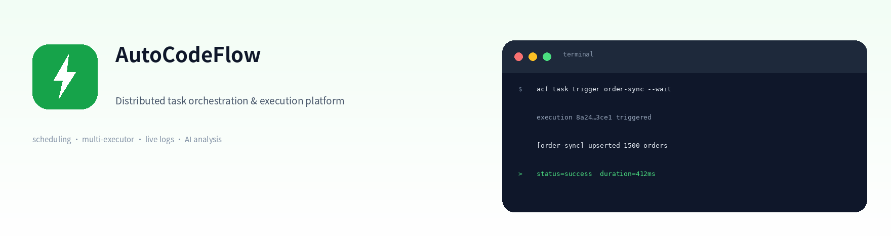
</p>

<p align="center">
  Schedule scripts · Give AI agents hands on a real desktop ·<br/>
  Keep every run observable, auditable and replayable.
</p>

## 🧭 What it is

AutoCodeFlow is a **self-hosted automation runtime** that puts scheduled scripts, desktop actions and AI agents on one auditable scheduler:

- **Scheduled scripts** — cron / fixed rate / webhook / DAG, JS / Python / Shell; logs, retries, timeouts, concurrency gates and alerts.
- **Desktop automation** — Windows / Linux desktop executors with GUI + browser actions, for internal systems and employee PCs that have no API.
- **Agent execution** — an MCP server lets Claude / Cursor create, trigger and debug jobs; SOPs let an agent execute a "goal + acceptance" contract on a real machine and leave evidence behind.
- **Inside your network** — executors pull work (no inbound ports exposed), and private npm / PyPI dependencies install out of the box.

> Stable work to scripts, long-tail work to agents, every action auditable.

## ⚡ One-command demo

```bash
git clone https://github.com/LuluDeer/AutoCodeFlow.git
cd AutoCodeFlow
./scripts/demo.sh
```

The script generates random secrets, starts an **isolated** local stack (it never touches your `.env`), seeds 3 demo tasks + 3 SOPs, triggers one run and waits for `SUCCESS`, then prints the UI URL and admin password. The first run builds images (~3–8 minutes depending on network); later starts take ~30 seconds:

- UI: **http://localhost:8088**
- API docs: http://127.0.0.1:3105/api/docs
- Stop: `./scripts/demo.sh --down`; reset: `./scripts/demo.sh --reset`

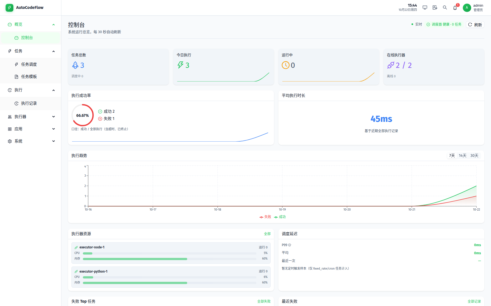

从模板创建 → 触发 → 产物（无需写代码）：

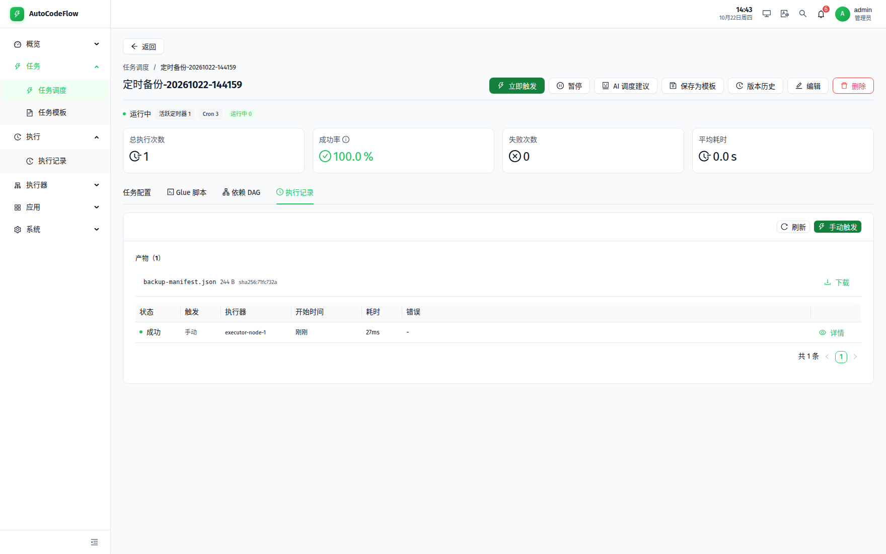

## 🖥️ Desktop Agent demo (Linux X11)

```bash
./scripts/demo-desktop-agent.sh   # no Docker, no LLM, no API key
```

It runs **SOP → plan → GUI actions → sandboxed trial → acceptance → delivered**: the control flow, gates, `X11GuiDriver`, workspace sandbox and acceptance path are production code. The plan is scripted by default (no key); set `ACF_LLM_API_KEY` / `ACF_LLM_BASE_URL` / `ACF_LLM_MODEL` to use a real OpenAI-compatible provider (verified with `deepseek-v4.1-flash-1017`). For a driver-only check, use `./scripts/demo-desktop-gui.sh`.

Headless executor (no Electron): `./scripts/demo-headless-agent.mjs` registers an executor, assigns a real SOP, and runs `AgentHost` → center LLM relay → sandboxed trial → acceptance → `completed` (AI provider required).

Multimodal: `/agent-collab/llm` accepts `text + image_url`. The executor attaches GUI screenshots as inline `data:image/png;base64` by default (verified: the provider reads real screenshots directly, no public media host needed); images over 1.5MB fall back to `ACF_MEDIA_BASE_URL`.

Screenshot-diagnosis loop: `./scripts/demo-desktop-agent-diagnose.sh` intentionally types `wrong-token`; the real model reads the screenshot, clears it, types the correct token, and reaches `delivered` (`ACF_LLM_*` required).

Center ops Agent: `node scripts/demo-ops-agent.mjs` — the real model calls `get_execution_stats`/`list_executions`/`get_execution_logs` in an `ops_watch` session and returns a readable analysis (AI provider required).

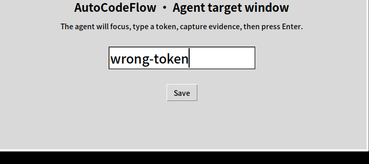

## 🎯 Three ways to use it

| What you want | What to use | Where to start |
|---|---|---|
| Turn scattered crontabs into observable jobs | Scheduled scripts + executors | Tasks → New (or Task templates) |
| Automate an internal/desktop system with no API | Desktop executor + GUI/browser | Executors → Install wizard |
| Let an AI agent actually do the work | MCP server + SOPs | `acf` CLI / MCP / SOP page |

## 🆚 Why not…

| Option | It is good at | It does not cover |
|---|---|---|
| crontab / systemd timer | Single-machine scheduling | Fleet, logs, retries, audit, desktop |
| XXL-JOB / Kestra | Server-side script orchestration | Desktop GUI, browser, AI agents |
| n8n / Dify | SaaS / API workflows | Self-hosted executors, desktop, private registries |
| UiPath / Yingdao | Commercial RPA | Open source, self-hosting, code-first, script scheduling |
| **AutoCodeFlow** | Scripts + desktop + agents on one scheduler | Not a big-data engine, not managed SaaS |

## 🧑‍💻 Who it is for / not for

**For**: developers and ops who can run Docker, have internal machines or employee desktops, and need logs / audit / self-hosting.
**Not for**: teams that want a managed SaaS, need Spark/Flink-scale data orchestration, or refuse to touch a terminal.

> Desktop GUI status: Linux X11/XWayland is verified on real machines; Windows GUI is beta (focus/click/type/screenshot + app allow-list); macOS is recon only. See the [executor agent roadmap](docs/design/agent-and-deployment/06-roadmap.md).

> **Status**: early-stage / self-hosted first. APIs may still change before 2.0; pin a release tag for production.

## 🖼️ Screenshots

### Admin console

**Dashboard** — task totals, success rate, execution trend, scheduler latency and executor resources.

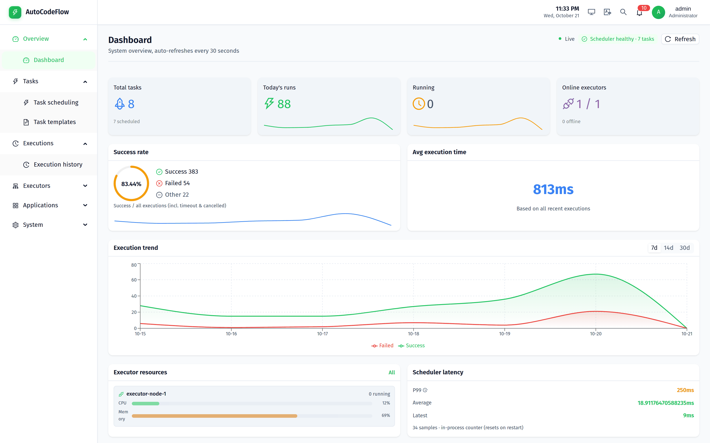

**Task scheduling** — cron / fixed-rate / manual tasks with status, next run and runtime.

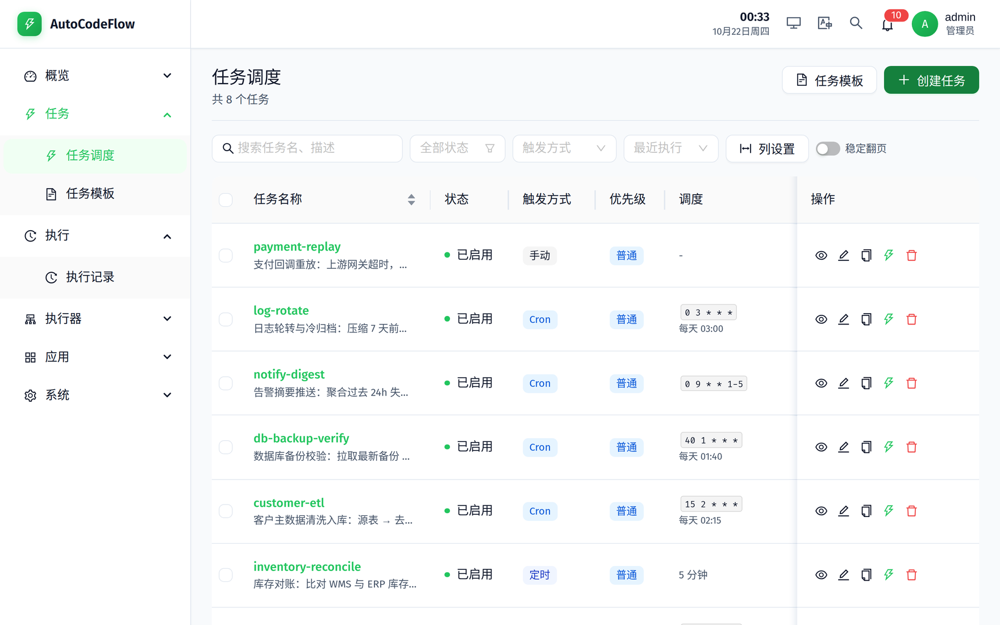

**Execution history** — every run, filterable by status, executor and time window.

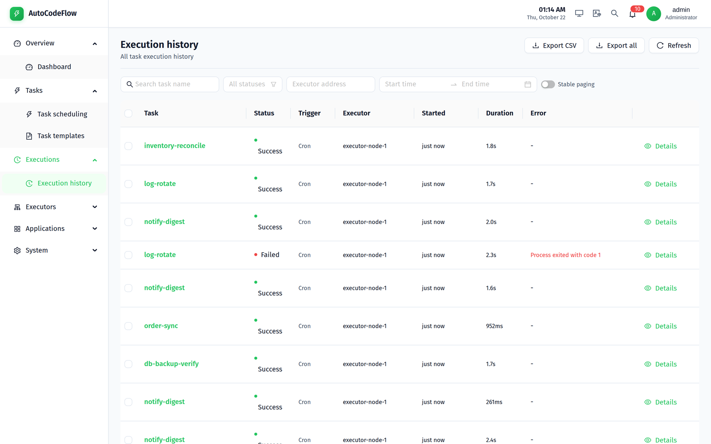

**Execution detail** — logs, timeline, retry chain, parameters and artifacts.

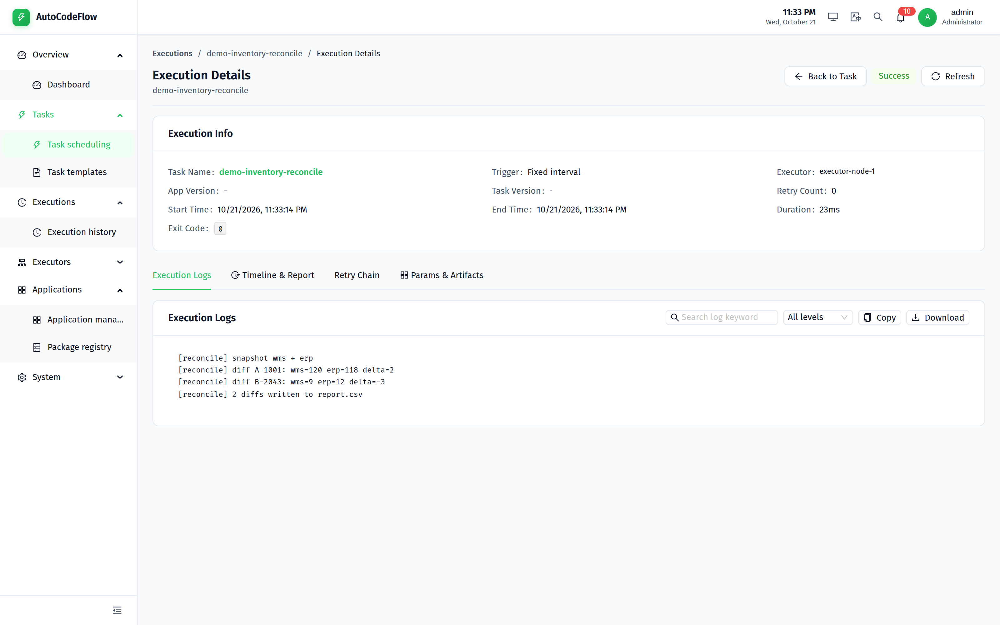

**Executors** — online state, CPU / memory / disk, heartbeat and task concurrency.

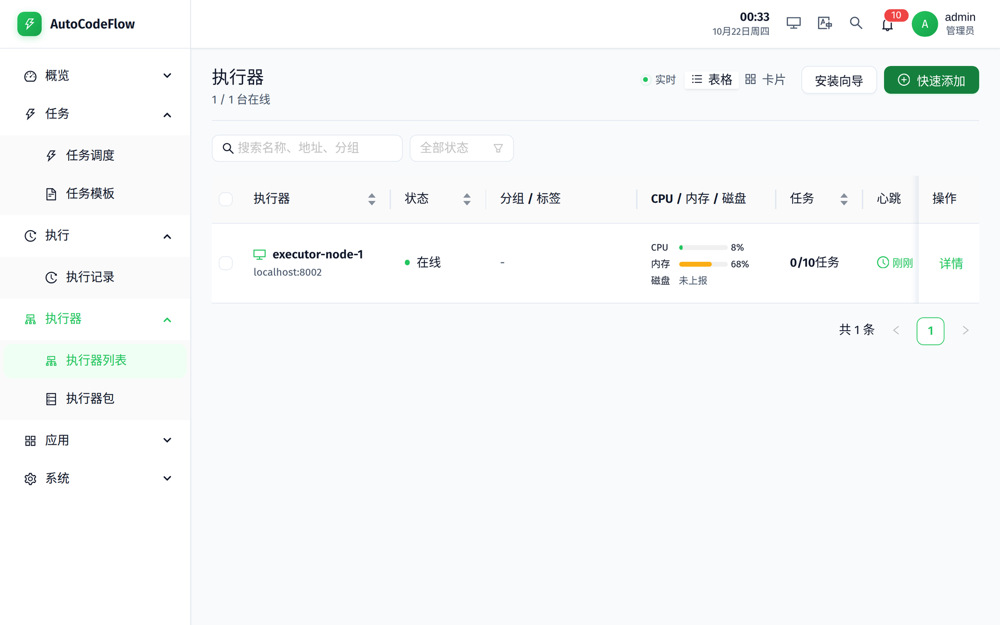

**Executor detail** — resource trend, success rate, interpreter pool and token rotation.

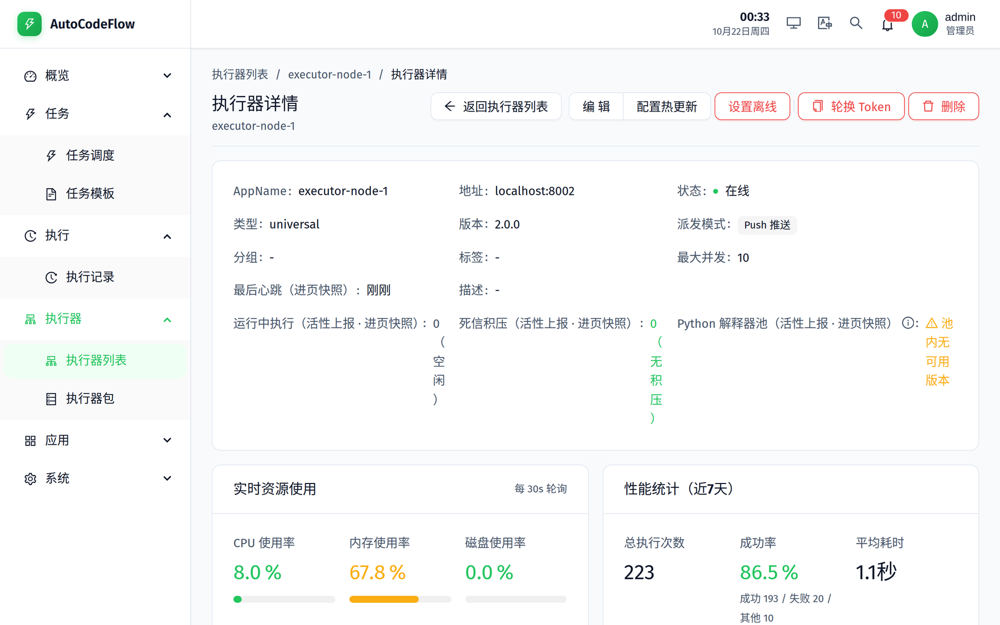

**Task detail** — glue script, dependency DAG, runs, version history and rollback.

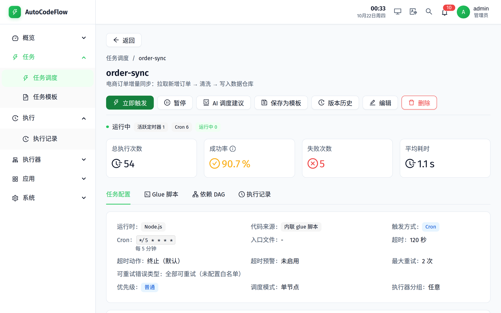

**Applications** — app versions, deployment state, bulk upgrade and canary rollout.

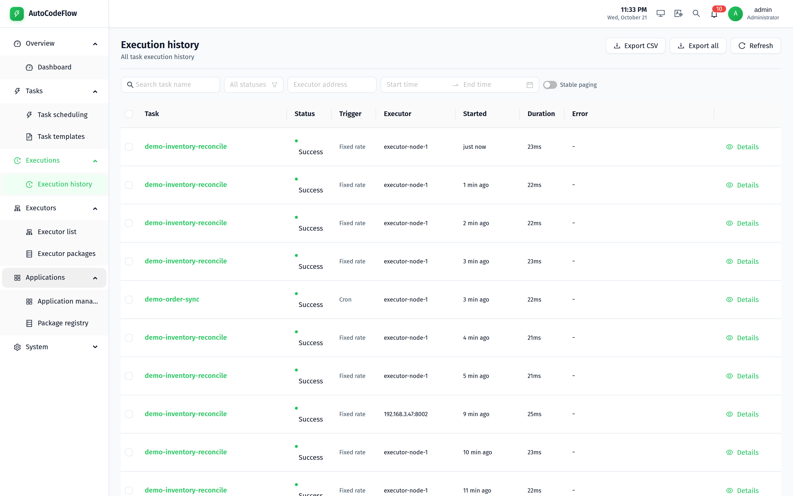

### Desktop executor

An Electron executor that installs on any machine, stays in the system tray, registers itself and receives scheduled work.

**Setup wizard** — five steps: connection, machine info, download source, confirmation.

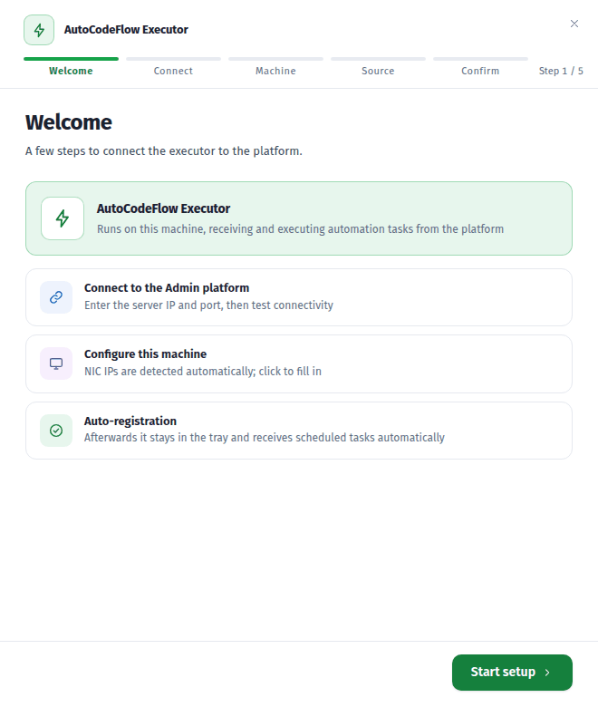

**Status** — online state, heartbeat, live run logs and recent failures.

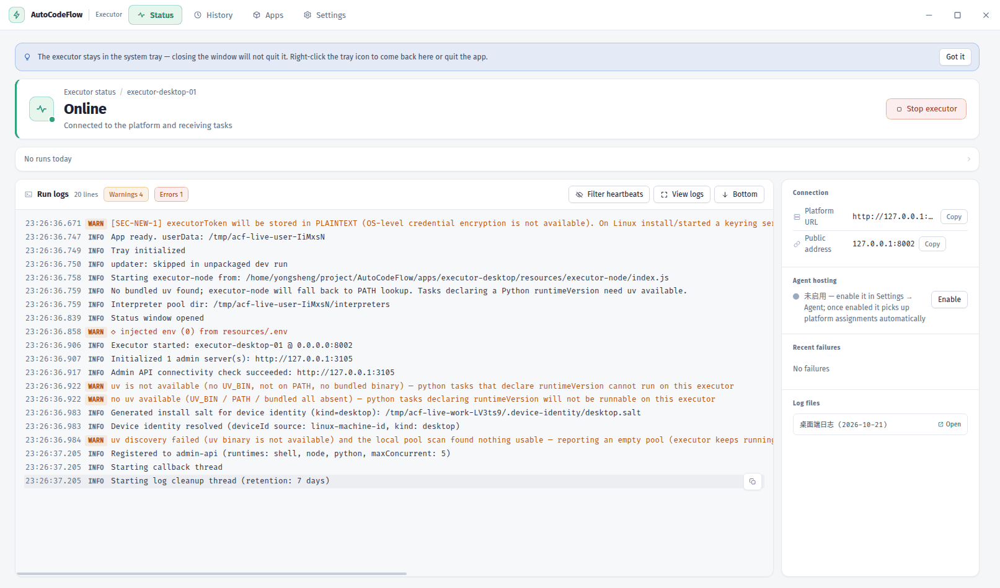

**Run history** — runs grouped by task with failure reasons inline.

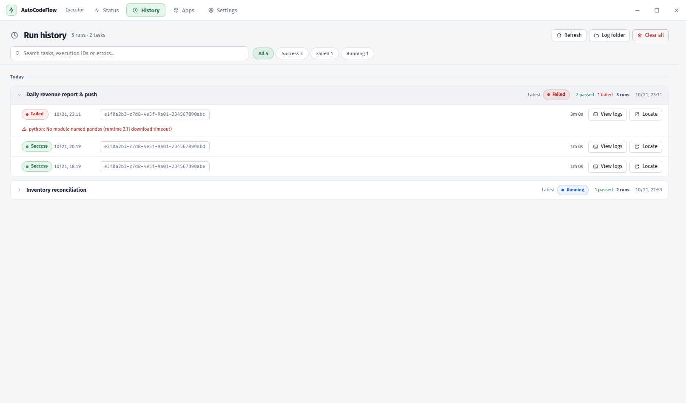

**Local apps** — deployed apps, side-by-side versions, uninstall and rollback.

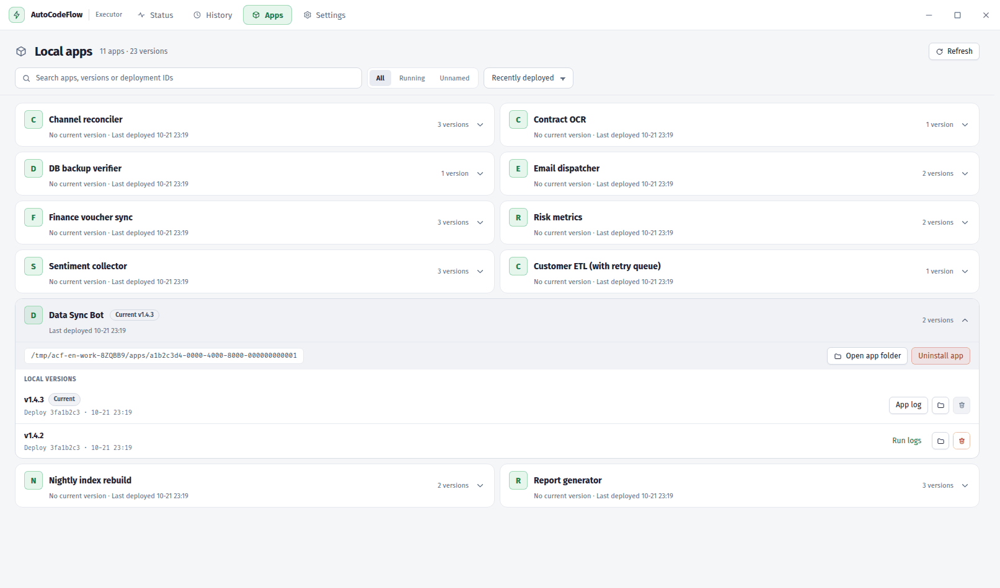

> Chinese UI screenshots live in `docs/assets/screenshots/zh/`.

## 🏗️ Architecture

<p align="center">
  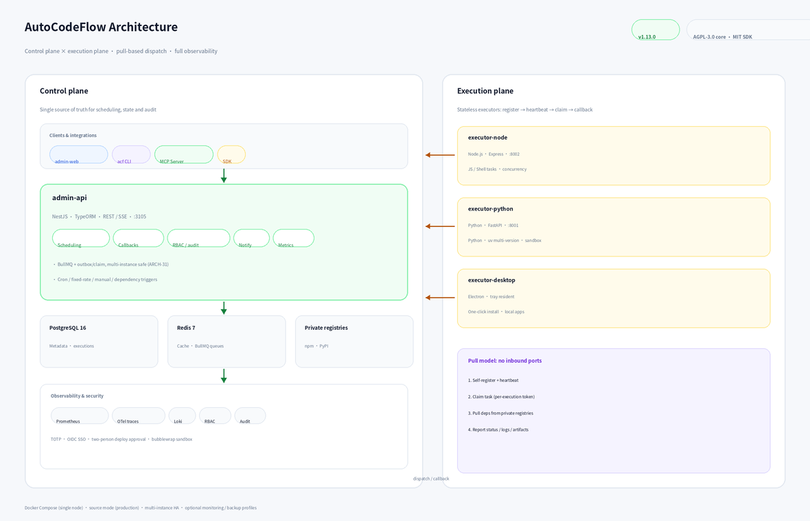
</p>

The **control plane** (admin-api + admin-web + PostgreSQL + Redis) owns every scheduling decision, state transition and audit record.
The **execution plane** (executor-node / executor-python / executor-desktop) is stateless: it registers, heartbeats, claims work and reports back.

```
Browser / CLI / MCP / SDK
        │  REST + SSE
        ▼
┌──────────────────────────────────────────────┐
│ admin-api (NestJS, :3105)                    │
│  · scheduler: cron / fixed-rate / DAG / manual│
│  · callbacks → runs / log chunks / artifacts  │
│  · RBAC / API keys / audit / notifications    │
└───────┬──────────────────┬───────────────────┘
        │                  │
   PostgreSQL 16       Redis 7 + BullMQ
   (metadata/audit)    (queues / cache / coordination)
        ▲
        │ register / heartbeat / claim / callback (pull)
        │
┌───────┴────────────┬───────────────────┬──────────────────┐
│ executor-node      │ executor-python   │ executor-desktop │
│ JS / Shell tasks   │ Python tasks      │ desktop automation│
│ :8002              │ :8001 · uv        │ Electron tray app │
└────────────────────┴───────────────────┴──────────────────┘
        │ pull dependencies on demand
        ▼
 Private registries: npm (Verdaccio) · PyPI
```

End-to-end path: **create task → scheduler enqueues → executor claims → pull script/deps → execute → report status/logs/artifacts → notify + AI analysis**.
Per-module breakdowns live in the [Atlas](docs/atlas/README.md) and [ADRs](docs/adr/README.md).

## ✨ Features

| Area | Highlights |
|---|---|
| **Scheduling** | Cron (5-field + timezone), fixed rate, manual, inbound webhook, dependency DAG, maintenance windows |
| **Execution policy** | Timeout + warning ratio, max retries with retryable-error allowlist, concurrency gates / mutex groups, block & misfire strategies, executor affinity tags |
| **Fleet** | Node.js / Python / Electron executors; self-registration, heartbeat liveness, load-aware dispatch, multi-instance consistency (outbox + claim) |
| **Code delivery** | Inline Glue scripts (editor, lint, AI generation), Git repos, application zips; private npm/PyPI dependency install |
| **Observability** | SSE live logs, execution trends, scheduler latency, Prometheus metrics, OpenTelemetry traces, Loki log aggregation |
| **Alerting** | WeCom, DingTalk, Slack webhooks, SMTP email; rules, silences, HMAC-signed webhooks |
| **Security** | Project-scoped RBAC, scoped API keys, TOTP 2FA, OIDC SSO, audit logs, two-person deploy approval, optional bubblewrap sandbox for Python tasks (secure overlay) |
| **AI** | OpenAI / Ollama / Qwen for script generation, failure root-cause analysis, schedule suggestions and app health checks; MCP server for agents |
| **Tooling** | `acf` CLI (67 subcommands), Node/Python SDKs, MCP server (56 tools), VitePress docs site |

## 🚀 Quick start

> Want to see it first? `./scripts/demo.sh` starts an isolated, seeded stack on non-default ports (it never touches `.env`) in ~1–3 minutes. The options below are for custom deployments.

### Option 1 — Docker Compose (recommended for a trial)

```bash
git clone https://github.com/LuluDeer/AutoCodeFlow.git
cd AutoCodeFlow

cp .env.example .env
# Required: INITIAL_ADMIN_PASSWORD (>= 8 chars; weak values are rejected at boot)
#           POSTGRES_PASSWORD / JWT_SECRET / JWT_REFRESH_SECRET / EXECUTOR_SECRET
vim .env

docker compose up -d
docker compose ps          # every service should be healthy
```

Open **http://localhost** and sign in with the admin account from `.env`. Change the password right after the first login.

### Option 2 — One-command deployment (production)

`deploy.sh` supports **source mode** and **Docker mode** with an 8-stage pipeline:
preflight → config → dependencies → build → infrastructure → migration (auto backup) → start → verify.

```bash
sudo ./deploy.sh --mode source --env production --i-know-its-production   # production, source mode
./deploy.sh --mode docker --env staging --build                          # staging
./deploy.sh doctor                                                       # pre-flight diagnosis
./deploy.sh doctor --json                                                # machine-readable diagnosis
```

### Option 3 — Local development

```bash
make infra-up                                  # PostgreSQL + Redis
make install                                   # install all dependencies
cd apps/admin-api && npm run migration:run && cd ../..
make dev                                       # admin-api + admin-web + both executors
```

### Seed demo data

```bash
make demo-seed    # demo-* tasks, executions and SOPs (requires a running admin-api)
```

### Endpoints

| Service | URL | Notes |
|---|---|---|
| Admin console | http://localhost | admin-web behind nginx in production |
| API docs | http://localhost:3105/api/docs | Swagger / OpenAPI |
| Health | http://localhost:3105/api/health/live · `/api/health/ready` | liveness / readiness |
| Prometheus metrics | http://localhost:3105/api/metrics | JWT required; disable with `METRICS_PROMETHEUS_ENABLED=false` |
| npm registry | http://localhost/npm/ | Verdaccio |
| PyPI registry | http://localhost/pypi/ | self-hosted FastAPI registry |
| Executors | :8001 (python) · :8002 (node) | bound to 127.0.0.1 by default |

> Observability is opt-in via profiles: `docker compose --profile monitoring up -d`
> (Prometheus :9090 · Grafana :3000 · Alertmanager :9093 · Loki :3100), `--profile jaeger` (Jaeger UI :16686),
> `--profile backup`, `--profile minio`, `--profile replica`.

## 🛠️ Clients & integrations

### CLI (`acf`)

```bash
npm install -g @autocodeflow/cli

acf login --url http://localhost:3105 --user admin        # interactive login (TOTP supported)
acf task list                                             # list tasks
acf task trigger <taskId> --wait                          # trigger and wait for a terminal state
acf task logs <execId> --tail 200                         # fetch execution logs
acf executor list                                         # list executors
acf app deploy <appId> --executor <id>                    # deploy an app to an executor
```

For CI, inject credentials through `ACF_API_URL` / `ACF_TOKEN` (nothing is persisted).
Full command map: [CLI reference](docs/atlas/05-interfaces/cli.md).

### SDKs

```bash
npm install @autocodeflow/sdk     # Node.js
pip install autoflow-sdk          # Python
```

Inside an **SDK task**, import `ctx` explicitly (Glue scripts use the system runtime and do not install requirements; use an application package or a dependency channel when you need the SDK):

```js
// Node.js — declare @autocodeflow/sdk in the task dependencies
const { TaskContext } = require('@autocodeflow/sdk');
const ctx = TaskContext.fromEnv();
async function main() {
  const res = await ctx.http.get('/api/tasks?pageSize=5');
  ctx.logger.info('tasks fetched', { meta: { count: res.list.length } });
  return ctx.success('done', { count: res.list.length });
}
main().catch((err) => { ctx.logger.error(err.message); process.exitCode = 1; });
```

```python
# Python — install autoflow-sdk
from autoflow_sdk import TaskContext
ctx = TaskContext.from_env()
rows = load_rows()                      # your business code
ctx.log.info("rows=%d", len(rows))
ctx.report_success(summary="etl done", duration_ms=412)
```

Capability matrix and known divergences: [SDK guide](docs/sdk-guide.md). Runnable examples: [examples/](examples/README.md).

### MCP server (AI agents)

```json
{
  "mcpServers": {
    "autocodeflow": {
      "command": "npx",
      "args": ["-y", "autocodeflow-mcp-server"],
      "env": {
        "AUTOCODEFLOW_API_URL": "http://localhost:3105",
        "AUTOCODEFLOW_API_TOKEN": "<your-jwt-token>"
      }
    }
  }
}
```

56 tools cover tasks, executions, executors, app deployments, SOPs, audit and approvals; permissions are enforced server-side from the JWT role.
See [packages/mcp-server/README.md](packages/mcp-server/README.md).

## 📦 Tech stack

| Layer | Technology |
|---|---|
| **Control plane** | NestJS · TypeORM · PostgreSQL 16 · Redis 7 · BullMQ |
| **Admin console** | React 19 · Vite · Ant Design · TypeScript · Recharts |
| **Executors** | Node.js 24 (Express) · Python 3.12 (FastAPI) · Electron |
| **Private registries** | Verdaccio (npm) · self-hosted FastAPI (PyPI) |
| **CLI / SDK / MCP** | Commander.js · axios / httpx · MCP SDK |
| **Observability** | Prometheus · Grafana · Loki · OpenTelemetry · Alertmanager |
| **Deployment** | Docker Compose · source mode (systemd + nginx) · multi-instance HA |

## 🗂️ Repository layout

```
AutoCodeFlow/
├── apps/
│   ├── admin-api/         control plane (REST + SSE + scheduler + audit)
│   ├── admin-web/         admin console SPA
│   ├── executor-node/     Node.js executor (:8002)
│   ├── executor-python/   Python executor (:8001, uv multi-version)
│   ├── executor-desktop/  Electron desktop executor (tray resident)
│   ├── registry-npm/      private npm registry config (Verdaccio)
│   └── registry-pypi/     private PyPI registry (FastAPI)
├── packages/
│   ├── acf-cli/           the acf command line tool
│   ├── mcp-server/        MCP server for AI agents
│   ├── autocodeflow-node-sdk/  Node.js SDK
│   ├── autoflow-sdk/      Python SDK
│   ├── executor-protocol/ executor protocol contract
│   └── docs-site/         VitePress documentation site
├── docs/                  documentation (entry: docs/README.md) · media: docs/assets/
├── examples/              runnable official examples
├── infra/                 reverse proxy, monitoring, infrastructure compose
├── scripts/               build, verification, self-test and guard scripts
└── deploy.sh              one-command deployment (source / docker)
```

Only repository-level files live at the root (README / LICENSE / CHANGELOG / CONTRIBUTING / SECURITY / deployment scripts and compose files).
Everything else belongs under [`docs/`](docs/README.md), and one-off reports under [`docs/archive/`](docs/archive/README.md) —
enforced by the `DOC-GOV` CI guard (`scripts/docs/check-docs.mjs`: dead links / orphan docs / root hygiene).

## 📚 Documentation

| Document | Description |
|---|---|
| [**Documentation hub**](docs/README.md) | **Start here** — every doc indexed by role |
| [Quick start](docs/quickstart.md) | First scheduled task in five minutes |
| [Deployment guide](docs/deployment.md) | Requirements, environment variables, upgrade and rollback |
| [Operations manual](docs/operations.md) | Day-2 operations, backup/restore, scaling, troubleshooting |
| [Development guide](docs/development.md) | Local setup, tests, conventions |
| [SDK guide](docs/sdk-guide.md) | Node / Python SDK capability matrix and usage |
| [API reference](docs/api-reference.md) | REST contracts, auth, error codes |
| [Architecture atlas](docs/atlas/README.md) | Complete structural breakdown of the project |
| [Tutorials](docs/tutorials/index.md) | Five tutorials in production order |
| [ADRs](docs/adr/README.md) | Read before changing the architecture |
| [Observability](docs/observability/README.md) | Metrics, logs, traces and alerting |
| [Support](SUPPORT.md) · [Security](SECURITY.md) | Where to ask, how to report a vulnerability |

## 🔒 Security

- **RBAC** — project-scoped roles (owner / developer / viewer), route-level guards enforced in CI (`check-route-authz-matrix`).
- **Credentials** — scoped API keys, per-execution callback tokens, executor shared-token rotation, TOTP 2FA, OIDC SSO.
- **Isolation** — optional optional bubblewrap sandbox for Python tasks (secure overlay) (user namespaces, read-only root, private tmp) and a child-process env allowlist.
- **Network** — all outbound requests go through an SSRF guard with DNS pinning (private ranges denied by default, opt-in per integration).
- **Audit** — full operation audit trail, two-person approval for deployments, replayable configuration history.
- **Supply chain** — dependency review log, secret scanning (gitleaks), multi-arch image build gate, release hygiene audit.

Please report vulnerabilities privately per [SECURITY.md](SECURITY.md) instead of opening a public issue.

## 🤝 Contributing

1. Fork the repository and create a branch: `git checkout -b feat/your-feature`
2. Commit using [Conventional Commits](https://www.conventionalcommits.org/)
3. Run the relevant tests (`npm run test:api` / `test:web` / `test:python` …)
4. Open a pull request and fill in the checklist (see [CONTRIBUTING.md](CONTRIBUTING.md))

CI covers admin-api, admin-web, all executors, both SDKs, the CLI, the MCP server, deployment scripts and documentation guards.

## 📄 License

Since v1.4.0 AutoCodeFlow uses **component-based licensing**:

| Component | License |
|---|---|
| **Platform core** (`apps/*` + `packages/docs-site`) | [AGPL-3.0-only](LICENSE) |
| **Client SDKs & tools** (CLI, Node/Python SDKs, MCP server) | MIT |
| **Executor protocol** (third-party executor integration) | MIT |

Versions up to v1.3.0 remain MIT.

## 🙏 Acknowledgments

[NestJS](https://nestjs.com/) · [React](https://react.dev/) · [Ant Design](https://ant.design/) ·
[TypeORM](https://typeorm.io/) · [BullMQ](https://docs.bullmq.io/) · [Electron](https://www.electronjs.org/) ·
[Vite](https://vite.dev/) · [FastAPI](https://fastapi.tiangolo.com/) · [Verdaccio](https://verdaccio.org/)

---

<p align="center"><sub>© 2026 LuluDeer · built with ❤️ in TypeScript &amp; Python</sub></p>

---


---

📖 **[查看中文版](README.md#chinese) | View Chinese Version**
