<h1 align="center">AutoCodeFlow</h1>

<p align="center">
  <b>分布式任务编排与执行平台</b><br/>
  <sub>Distributed task orchestration &amp; execution platform</sub>
</p>

<p align="center">
  <a href="https://github.com/LuluDeer/AutoCodeFlow/actions/workflows/ci.yml"></a>
  <a href="https://github.com/LuluDeer/AutoCodeFlow/actions/workflows/release.yml"></a>
  <a href="https://github.com/LuluDeer/AutoCodeFlow/releases"></a>
  <a href="LICENSE"></a>
  <a href="https://www.npmjs.com/package/@autocodeflow/sdk"></a>
  <a href="https://pypi.org/project/autoflow-sdk/"></a>
  <a href="https://luludeer.github.io/AutoCodeFlow/"></a>
</p>

<p align="center">
  <a href="#chinese"><b>中文</b></a> ·
  <a href="#english"><b>English</b></a> ·
  <a href="docs/README.md">文档中心 / Docs hub</a> ·
  <a href="docs/quickstart.md">5 分钟上手</a> ·
  <a href="docs/deployment.md">部署指南</a>
</p>

---

<a name="english"></a>

# AutoCodeFlow

<p align="center">
  
</p>

<p align="center">
  Write JavaScript / Python scripts in the browser, schedule them by cron or events,<br/>
  dispatch them safely to a fleet of executors — and collect logs, artifacts, alerts, audit trails<br/>
  and AI failure analysis in one place.
</p>

## 🧭 What it is

AutoCodeFlow turns "cron scripts scattered across machines" into **schedulable, observable, auditable and rollback-able** jobs:

- **Author** — write Glue scripts (JS / Python / Shell) in the console, or ship code via Git repos and application bundles.
- **Schedule** — cron, fixed rate, manual, inbound webhook and dependency DAGs, with retries, timeouts, concurrency gates and maintenance windows.
- **Execute** — executors self-register, heartbeat and **pull** work (no inbound ports exposed), with load-aware dispatch across the fleet.
- **Observe** — live logs over SSE, execution trends, Prometheus metrics, OpenTelemetry traces, failure classification and AI root-cause analysis.
- **Govern** — RBAC, scoped API keys, TOTP 2FA, OIDC SSO, audit logs and two-person approval for deployments.

| Scenario | What AutoCodeFlow runs |
|---|---|
| Data pipelines | Incremental sync, cleaning and warehousing with automatic retry and alerting |
| Scheduled reports | Daily business reports rendered and pushed to WeCom / DingTalk / Slack |
| Operations | Backup verification, log rotation and cold archiving, certificate renewal |
| API integration | Third-party polling, webhooks, event-driven orchestration |
| Desktop automation | RPA-style local UI tasks on the Electron desktop executor |
| AI agents | Let Claude / Cursor create, trigger and debug tasks through the MCP server |

## 🖼️ Screenshots

### Admin console (admin-web)

<table>
  <tr>
    <td width="50%" align="center"><b>Dashboard</b><br/><sub>Task totals, success rate, execution trend, scheduler latency, executor resources</sub></td>
    <td width="50%" align="center"><b>Task scheduling</b><br/><sub>Cron / fixed-rate / manual with status, next run and runtime</sub></td>
  </tr>
  <tr>
    <td></td>
    <td></td>
  </tr>
  <tr>
    <td align="center"><b>Execution history</b><br/><sub>Full run history, filterable by status, executor and time</sub></td>
    <td align="center"><b>Execution detail</b><br/><sub>Logs, timeline, retry chain, params and artifacts</sub></td>
  </tr>
  <tr>
    <td></td>
    <td></td>
  </tr>
  <tr>
    <td align="center"><b>Executors</b><br/><sub>Online state, CPU / memory / disk, heartbeat, task concurrency</sub></td>
    <td align="center"><b>Executor detail</b><br/><sub>Resource trend, success rate, interpreter pool, token rotation</sub></td>
  </tr>
  <tr>
    <td></td>
    <td></td>
  </tr>
  <tr>
    <td align="center"><b>Task detail</b><br/><sub>Glue script, dependency DAG, runs, version history and rollback</sub></td>
    <td align="center"><b>Applications</b><br/><sub>App versions, deployment state, bulk upgrade and canary rollout</sub></td>
  </tr>
  <tr>
    <td></td>
    <td></td>
  </tr>
</table>

### Desktop executor (executor-desktop)

An Electron executor that installs on any machine, stays in the system tray, registers itself and receives scheduled work.

<table>
  <tr>
    <td width="50%" align="center"><b>Setup wizard</b><br/><sub>Five steps: connection, machine info, download source, confirmation</sub></td>
    <td width="50%" align="center"><b>Status</b><br/><sub>Online state, heartbeat, live run logs, recent failures</sub></td>
  </tr>
  <tr>
    <td></td>
    <td></td>
  </tr>
  <tr>
    <td align="center"><b>Run history</b><br/><sub>Runs grouped by task with failure reasons inline</sub></td>
    <td align="center"><b>Local apps</b><br/><sub>Deployed apps, side-by-side versions, uninstall and rollback</sub></td>
  </tr>
  <tr>
    <td></td>
    <td></td>
  </tr>
</table>

> Chinese UI screenshots live in `docs/assets/screenshots/zh/`.

## 🏗️ Architecture

<p align="center">
  
</p>

The **control plane** (admin-api + admin-web + PostgreSQL + Redis) owns every scheduling decision, state transition and audit record.
The **execution plane** (executor-node / executor-python / executor-desktop) is stateless: it registers, heartbeats, claims work and reports back.

```
Browser / CLI / MCP / SDK
        │  REST + SSE
        ▼
┌──────────────────────────────────────────────┐
│ admin-api (NestJS, :3105)                    │
│  · scheduler: cron / fixed-rate / DAG / manual│
│  · callbacks → runs / log chunks / artifacts  │
│  · RBAC / API keys / audit / notifications    │
└───────┬──────────────────┬───────────────────┘
        │                  │
   PostgreSQL 16       Redis 7 + BullMQ
   (metadata/audit)    (queues / cache / coordination)
        ▲
        │ register / heartbeat / claim / callback (pull)
        │
┌───────┴────────────┬───────────────────┬──────────────────┐
│ executor-node      │ executor-python   │ executor-desktop │
│ JS / Shell tasks   │ Python tasks      │ desktop automation│
│ :8002              │ :8001 · uv        │ Electron tray app │
└────────────────────┴───────────────────┴──────────────────┘
        │ pull dependencies on demand
        ▼
 Private registries: npm (Verdaccio) · PyPI
```

End-to-end path: **create task → scheduler enqueues → executor claims → pull script/deps → execute → report status/logs/artifacts → notify + AI analysis**.
Per-module breakdowns live in the [Atlas](docs/atlas/README.md) and [ADRs](docs/adr/README.md).

## ✨ Features

| Area | Highlights |
|---|---|
| **Scheduling** | Cron (5-field + timezone), fixed rate, manual, inbound webhook, dependency DAG, maintenance windows |
| **Execution policy** | Timeout + warning ratio, max retries with retryable-error allowlist, concurrency gates / mutex groups, block & misfire strategies, executor affinity tags |
| **Fleet** | Node.js / Python / Electron executors; self-registration, heartbeat liveness, load-aware dispatch, multi-instance consistency (outbox + claim) |
| **Code delivery** | Inline Glue scripts (editor, lint, AI generation), Git repos, application zips; private npm/PyPI dependency install |
| **Observability** | SSE live logs, execution trends, scheduler latency, Prometheus metrics, OpenTelemetry traces, Loki log aggregation |
| **Alerting** | WeCom, DingTalk, Slack webhooks, SMTP email; rules, silences, HMAC-signed webhooks |
| **Security** | Project-scoped RBAC, scoped API keys, TOTP 2FA, OIDC SSO, audit logs, two-person deploy approval, bubblewrap sandbox for Python tasks |
| **AI** | OpenAI / Ollama / Qwen for script generation, failure root-cause analysis, schedule suggestions and app health checks; MCP server for agents |
| **Tooling** | `acf` CLI (67 subcommands), Node/Python SDKs, MCP server (56 tools), VitePress docs site |

## 🚀 Quick start

### Option 1 — Docker Compose (recommended for a trial)

```bash
git clone https://github.com/LuluDeer/AutoCodeFlow.git
cd AutoCodeFlow

cp .env.example .env
# Required: INITIAL_ADMIN_PASSWORD (>= 8 chars; weak values are rejected at boot)
#           POSTGRES_PASSWORD / JWT_SECRET / JWT_REFRESH_SECRET / EXECUTOR_SECRET
vim .env

docker compose up -d
docker compose ps          # every service should be healthy
```

Open **http://localhost** and sign in with the admin account from `.env`. Change the password right after the first login.

### Option 2 — One-command deployment (production)

`deploy.sh` supports **source mode** and **Docker mode** with an 8-stage pipeline:
preflight → config → dependencies → build → infrastructure → migration (auto backup) → start → verify.

```bash
sudo ./deploy.sh --mode source --env production --i-know-its-production   # production, source mode
./deploy.sh --mode docker --env staging --build                          # staging
./deploy.sh doctor                                                       # pre-flight diagnosis
./deploy.sh doctor --json                                                # machine-readable diagnosis
```

### Option 3 — Local development

```bash
make infra-up                                  # PostgreSQL + Redis
make install                                   # install all dependencies
cd apps/admin-api && npm run migration:run && cd ../..
make dev                                       # admin-api + admin-web + both executors
```

### Seed demo data

```bash
make demo-seed    # demo-* tasks, executions and SOPs (requires a running admin-api)
```

### Endpoints

| Service | URL | Notes |
|---|---|---|
| Admin console | http://localhost | admin-web behind nginx in production |
| API docs | http://localhost:3105/api/docs | Swagger / OpenAPI |
| Health | http://localhost:3105/api/health/live · `/api/health/ready` | liveness / readiness |
| Prometheus metrics | http://localhost:3105/api/metrics | JWT required; disable with `METRICS_PROMETHEUS_ENABLED=false` |
| npm registry | http://localhost/npm/ | Verdaccio |
| PyPI registry | http://localhost/pypi/ | self-hosted FastAPI registry |
| Executors | :8001 (python) · :8002 (node) | bound to 127.0.0.1 by default |

> Observability is opt-in via profiles: `docker compose --profile monitoring up -d`
> (Prometheus :9090 · Grafana :3000 · Alertmanager :9093 · Loki :3100), `--profile jaeger` (Jaeger UI :16686),
> `--profile backup`, `--profile minio`, `--profile replica`.

## 🛠️ Clients & integrations

### CLI (`acf`)

```bash
npm install -g @autocodeflow/cli

acf login --url http://localhost:3105 --user admin        # interactive login (TOTP supported)
acf task list                                             # list tasks
acf task trigger <taskId> --wait                          # trigger and wait for a terminal state
acf task logs <execId> --tail 200                         # fetch execution logs
acf executor list                                         # list executors
acf app deploy <appId> --executor <id>                    # deploy an app to an executor
```

For CI, inject credentials through `ACF_API_URL` / `ACF_TOKEN` (nothing is persisted).
Full command map: [CLI reference](docs/atlas/05-interfaces/cli.md).

### SDKs

```bash
npm install @autocodeflow/sdk     # Node.js
pip install autoflow-sdk          # Python
```

Inside a task you get `ctx` for parameters, HTTP calls, logging and result reporting.

```js
// Node.js — Glue script shipped with the task
const res = await ctx.http.get('/api/tasks?pageSize=5');
ctx.logger.info('tasks fetched', { meta: { count: res.list.length } });
return ctx.success('done', { count: res.list.length });
```

```python
# Python — Glue script shipped with the task
rows = load_rows()                      # your business code
ctx.log.info("rows=%d", len(rows))
ctx.report_success(summary="etl done", duration_ms=412)
```

Capability matrix and known divergences: [SDK guide](docs/sdk-guide.md). Runnable examples: [examples/](examples/README.md).

### MCP server (AI agents)

```json
{
  "mcpServers": {
    "autocodeflow": {
      "command": "npx",
      "args": ["-y", "autocodeflow-mcp-server"],
      "env": {
        "AUTOCODEFLOW_API_URL": "http://localhost:3105",
        "AUTOCODEFLOW_API_TOKEN": "<your-jwt-token>"
      }
    }
  }
}
```

56 tools cover tasks, executions, executors, app deployments, SOPs, audit and approvals; permissions are enforced server-side from the JWT role.
See [packages/mcp-server/README.md](packages/mcp-server/README.md).

## 📦 Tech stack

| Layer | Technology |
|---|---|
| **Control plane** | NestJS · TypeORM · PostgreSQL 16 · Redis 7 · BullMQ |
| **Admin console** | React 19 · Vite · Ant Design · TypeScript · Recharts |
| **Executors** | Node.js 24 (Express) · Python 3.12 (FastAPI) · Electron |
| **Private registries** | Verdaccio (npm) · self-hosted FastAPI (PyPI) |
| **CLI / SDK / MCP** | Commander.js · axios / httpx · MCP SDK |
| **Observability** | Prometheus · Grafana · Loki · OpenTelemetry · Alertmanager |
| **Deployment** | Docker Compose · source mode (systemd + nginx) · multi-instance HA |

## 🗂️ Repository layout

```
AutoCodeFlow/
├── apps/
│   ├── admin-api/         control plane (REST + SSE + scheduler + audit)
│   ├── admin-web/         admin console SPA
│   ├── executor-node/     Node.js executor (:8002)
│   ├── executor-python/   Python executor (:8001, uv multi-version)
│   ├── executor-desktop/  Electron desktop executor (tray resident)
│   ├── registry-npm/      private npm registry config (Verdaccio)
│   └── registry-pypi/     private PyPI registry (FastAPI)
├── packages/
│   ├── acf-cli/           the acf command line tool
│   ├── mcp-server/        MCP server for AI agents
│   ├── autocodeflow-node-sdk/  Node.js SDK
│   ├── autoflow-sdk/      Python SDK
│   ├── executor-protocol/ executor protocol contract
│   └── docs-site/         VitePress documentation site
├── docs/                  documentation (entry: docs/README.md) · media: docs/assets/
├── examples/              runnable official examples
├── infra/                 reverse proxy, monitoring, infrastructure compose
├── scripts/               build, verification, self-test and guard scripts
└── deploy.sh              one-command deployment (source / docker)
```

Only repository-level files live at the root (README / LICENSE / CHANGELOG / CONTRIBUTING / SECURITY / deployment scripts and compose files).
Everything else belongs under [`docs/`](docs/README.md), and one-off reports under [`docs/archive/`](docs/archive/README.md) —
enforced by the `DOC-GOV` CI guard (`scripts/docs/check-docs.mjs`: dead links / orphan docs / root hygiene).

## 📚 Documentation

| Document | Description |
|---|---|
| [**Documentation hub**](docs/README.md) | **Start here** — every doc indexed by role |
| [Quick start](docs/quickstart.md) | First scheduled task in five minutes |
| [Deployment guide](docs/deployment.md) | Requirements, environment variables, upgrade and rollback |
| [Operations manual](docs/operations.md) | Day-2 operations, backup/restore, scaling, troubleshooting |
| [Development guide](docs/development.md) | Local setup, tests, conventions |
| [SDK guide](docs/sdk-guide.md) | Node / Python SDK capability matrix and usage |
| [API reference](docs/api-reference.md) | REST contracts, auth, error codes |
| [Architecture atlas](docs/atlas/README.md) | Complete structural breakdown of the project |
| [Tutorials](docs/tutorials/index.md) | Five tutorials in production order |
| [ADRs](docs/adr/README.md) | Read before changing the architecture |
| [Observability](docs/observability/README.md) | Metrics, logs, traces and alerting |
| [Support](SUPPORT.md) · [Security](SECURITY.md) | Where to ask, how to report a vulnerability |

## 🔒 Security

- **RBAC** — project-scoped roles (owner / developer / viewer), route-level guards enforced in CI (`check-route-authz-matrix`).
- **Credentials** — scoped API keys, per-execution callback tokens, executor shared-token rotation, TOTP 2FA, OIDC SSO.
- **Isolation** — optional bubblewrap sandbox for Python tasks (user namespaces, read-only root, private tmp) and a child-process env allowlist.
- **Network** — all outbound requests go through an SSRF guard with DNS pinning (private ranges denied by default, opt-in per integration).
- **Audit** — full operation audit trail, two-person approval for deployments, replayable configuration history.
- **Supply chain** — dependency review log, secret scanning (gitleaks), multi-arch image build gate, release hygiene audit.

Please report vulnerabilities privately per [SECURITY.md](SECURITY.md) instead of opening a public issue.

## 🤝 Contributing

1. Fork the repository and create a branch: `git checkout -b feat/your-feature`
2. Commit using [Conventional Commits](https://www.conventionalcommits.org/)
3. Run the relevant tests (`npm run test:api` / `test:web` / `test:python` …)
4. Open a pull request and fill in the checklist (see [CONTRIBUTING.md](CONTRIBUTING.md))

CI covers admin-api, admin-web, all executors, both SDKs, the CLI, the MCP server, deployment scripts and documentation guards.

## 📄 License

Since v1.4.0 AutoCodeFlow uses **component-based licensing**:

| Component | License |
|---|---|
| **Platform core** (`apps/*` + `packages/docs-site`) | [AGPL-3.0-only](LICENSE) |
| **Client SDKs & tools** (CLI, Node/Python SDKs, MCP server) | MIT |
| **Executor protocol** (third-party executor integration) | MIT |

Versions up to v1.3.0 remain MIT.

## 🙏 Acknowledgments

[NestJS](https://nestjs.com/) · [React](https://react.dev/) · [Ant Design](https://ant.design/) ·
[TypeORM](https://typeorm.io/) · [BullMQ](https://docs.bullmq.io/) · [Electron](https://www.electronjs.org/) ·
[Vite](https://vite.dev/) · [FastAPI](https://fastapi.tiangolo.com/) · [Verdaccio](https://verdaccio.org/)

---

<p align="center"><sub>© 2026 LuluDeer · built with ❤️ in TypeScript &amp; Python</sub></p>

---

<a name="chinese"></a>

# AutoCodeFlow

<p align="center">
  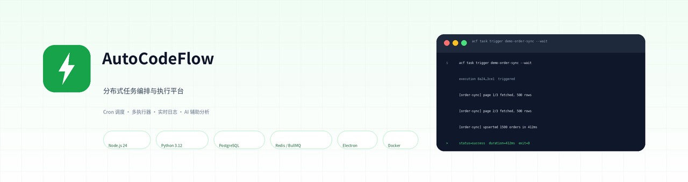
</p>

<p align="center">
  在浏览器里写 JavaScript / Python 脚本，按 Cron 或事件调度，安全地分发到多台执行器运行，<br/>
  并把日志、产物、告警、审计与 AI 失败分析一次性收齐。
</p>

## 🧭 这是什么

AutoCodeFlow 把「散落在各台机器上的定时脚本」变成**可调度、可观测、可审计、可回滚**的正式任务：

- **写代码** — 在管理后台直接写 Glue 脚本（JS / Python / Shell），或用 Git 仓库 / 应用包交付。
- **定策略** — Cron、固定频率、手动、Webhook、任务依赖 DAG；重试、超时、并发闸、维护窗口。
- **跑起来** — 执行器主动拉取任务（Pull 模型，不需要对公网暴露入站端口），自动注册、心跳保活、负载感知分发。
- **看得见** — 实时日志（SSE）、执行趋势、Prometheus 指标、OpenTelemetry 追踪、失败分类与 AI 根因分析。
- **管得住** — RBAC、作用域 API Key、TOTP 双因子、OIDC SSO、审计日志、部署第二人审批。

| 场景 | 用 AutoCodeFlow 做什么 |
|---|---|
| 数据管道 | 订单/客户数据增量同步、清洗、落仓，失败自动重试并告警 |
| 定时报表 | 每日经营日报生成 → 渲染 → 企业微信/钉钉/Slack 推送 |
| 系统运维 | 数据库备份校验、日志轮转与冷归档、证书续期 |
| API 集成 | 轮询第三方接口、Webhook 回调、事件驱动编排 |
| 桌面自动化 | 用 Electron 桌面执行器跑 RPA 风格的本地 UI 任务 |
| AI Agent | 通过 MCP Server 让 Claude / Cursor 直接创建、触发、排查任务 |

## 🖼️ 界面一览

### 中台（admin-web）

<table>
  <tr>
    <td width="50%" align="center"><b>控制台</b><br/><sub>任务总量、成功率、执行趋势、调度延迟、执行器资源</sub></td>
    <td width="50%" align="center"><b>任务调度</b><br/><sub>Cron / 固定频率 / 手动，状态、下次执行与运行时一目了然</sub></td>
  </tr>
  <tr>
    <td>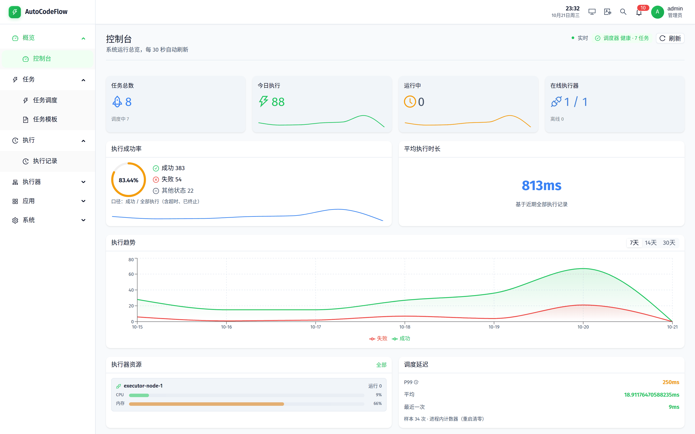</td>
    <td>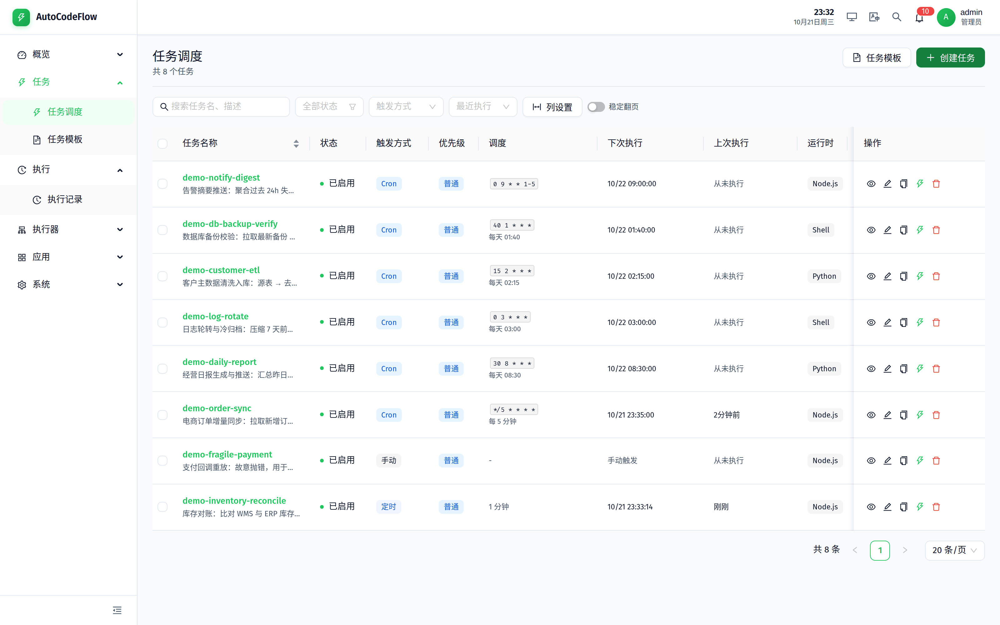</td>
  </tr>
  <tr>
    <td align="center"><b>执行记录</b><br/><sub>全量执行历史，按状态、执行器、时间过滤，实时刷新</sub></td>
    <td align="center"><b>执行详情</b><br/><sub>执行日志、时间线、重试链、参数与产物</sub></td>
  </tr>
  <tr>
    <td>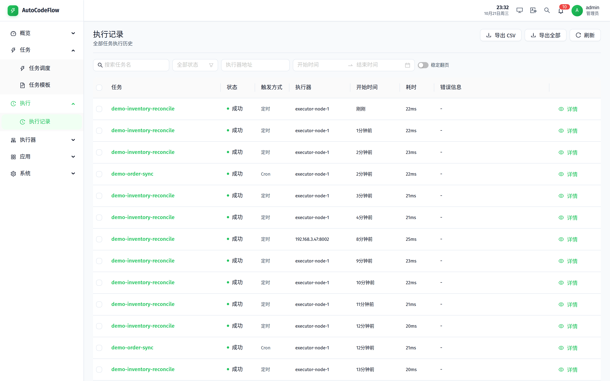</td>
    <td>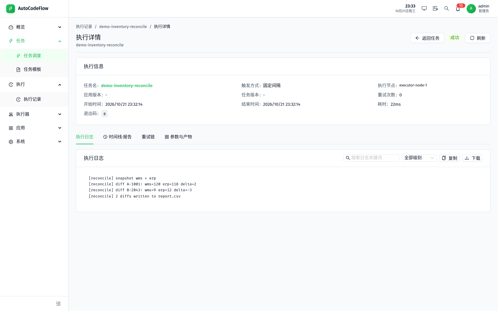</td>
  </tr>
  <tr>
    <td align="center"><b>执行器</b><br/><sub>在线状态、CPU / 内存 / 磁盘、心跳、任务并发</sub></td>
    <td align="center"><b>执行器详情</b><br/><sub>资源趋势、成功率、解释器池、令牌轮换</sub></td>
  </tr>
  <tr>
    <td>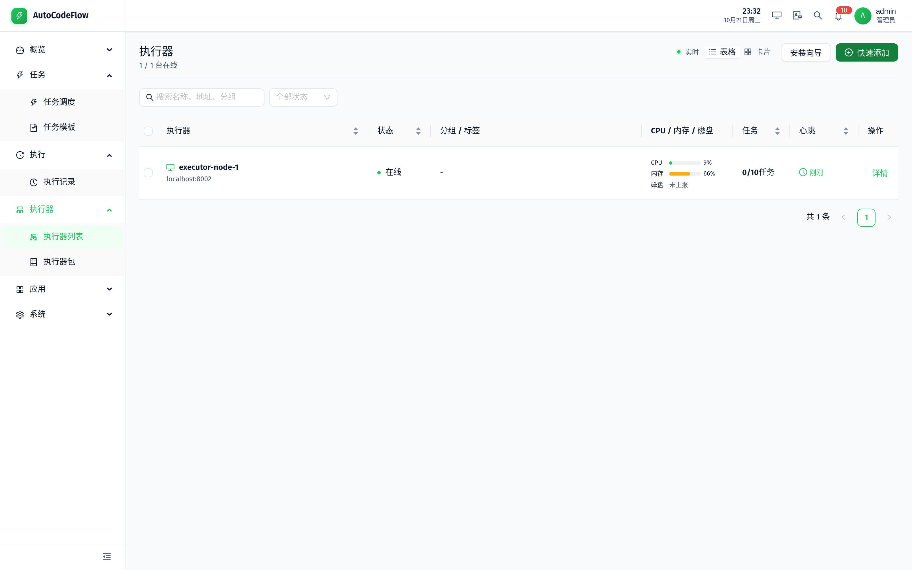</td>
    <td>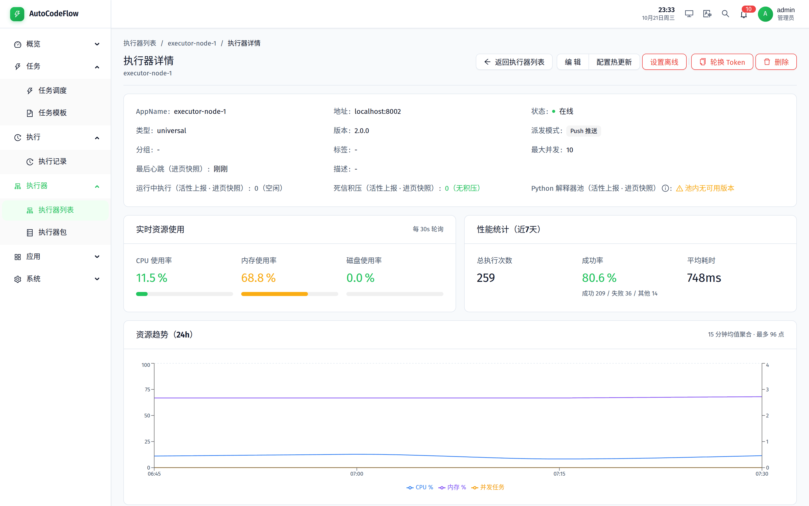</td>
  </tr>
  <tr>
    <td align="center"><b>任务详情</b><br/><sub>Glue 脚本、依赖 DAG、执行记录、版本历史与回滚</sub></td>
    <td align="center"><b>应用管理</b><br/><sub>应用版本、部署状态、批量升级与灰度</sub></td>
  </tr>
  <tr>
    <td>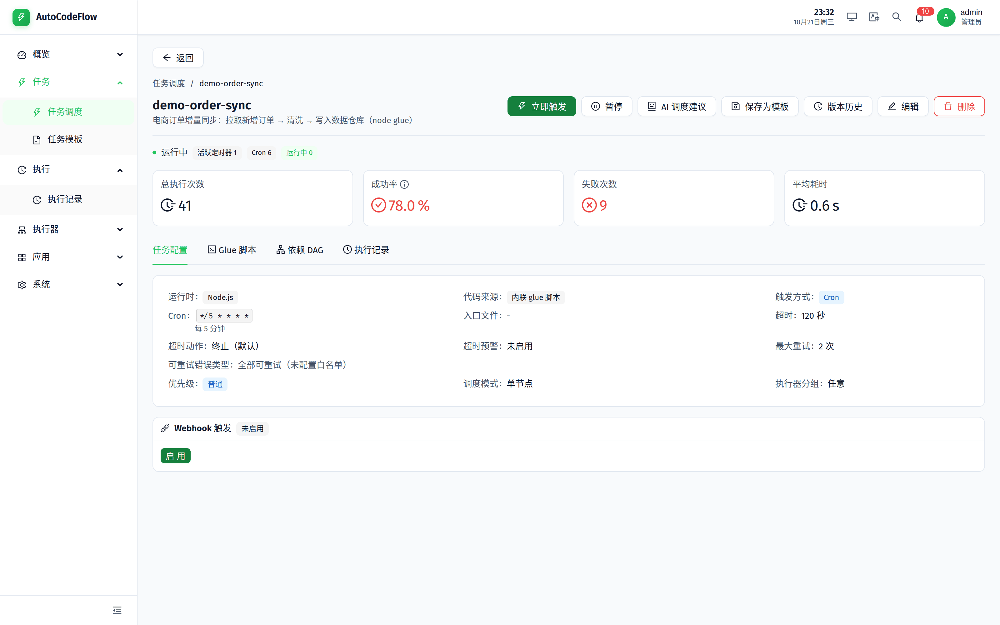</td>
    <td>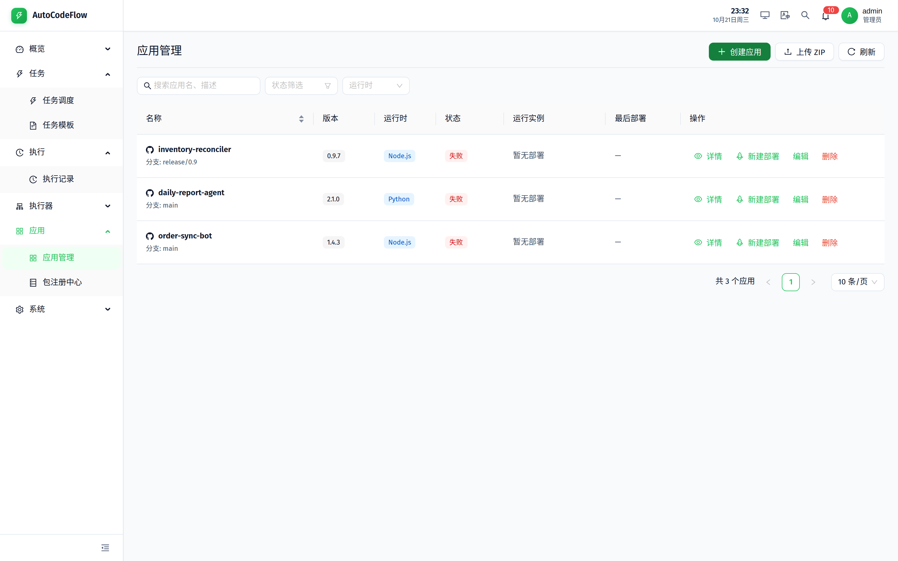</td>
  </tr>
</table>

### 执行器（executor-desktop）

Electron 桌面执行器：装在任何一台机器上，常驻系统托盘，自动注册上线并接收调度任务。

<table>
  <tr>
    <td width="50%" align="center"><b>连接向导</b><br/><sub>5 步完成连接、本机信息、下载源与确认</sub></td>
    <td width="50%" align="center"><b>状态监控</b><br/><sub>在线状态、心跳、实时运行日志、最近失败</sub></td>
  </tr>
  <tr>
    <td>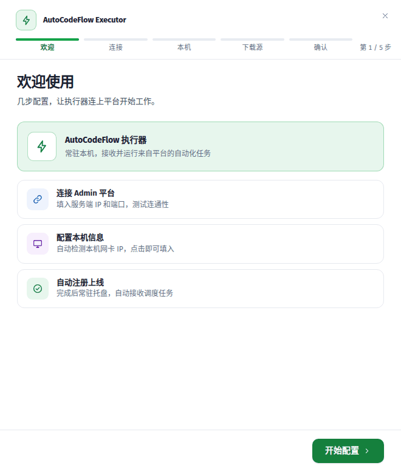</td>
    <td>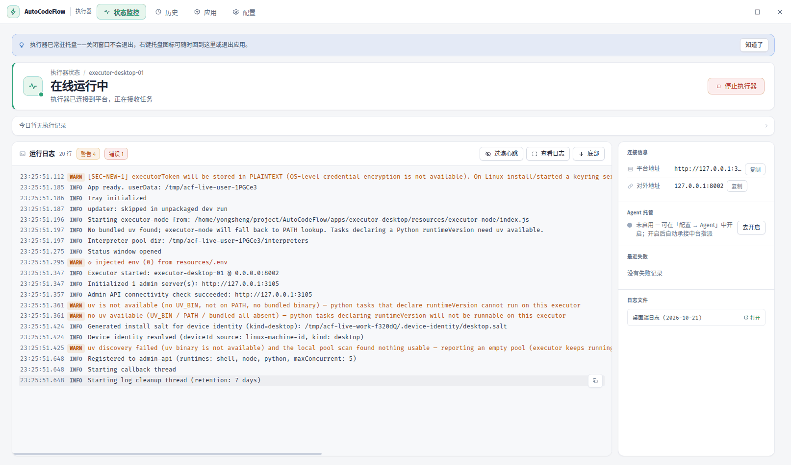</td>
  </tr>
  <tr>
    <td align="center"><b>执行历史</b><br/><sub>按任务分组的运行记录，失败原因直接可见</sub></td>
    <td align="center"><b>本地应用</b><br/><sub>已部署应用、多版本并存、卸载与版本回退</sub></td>
  </tr>
  <tr>
    <td>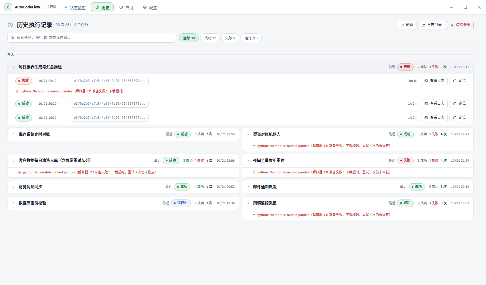</td>
    <td>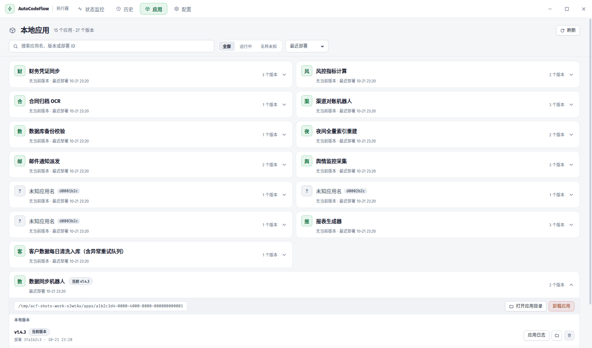</td>
  </tr>
</table>

> 英文界面截图见 [English](#english) 章节（`docs/assets/screenshots/en/`）。

## 🏗️ 系统架构

<p align="center">
  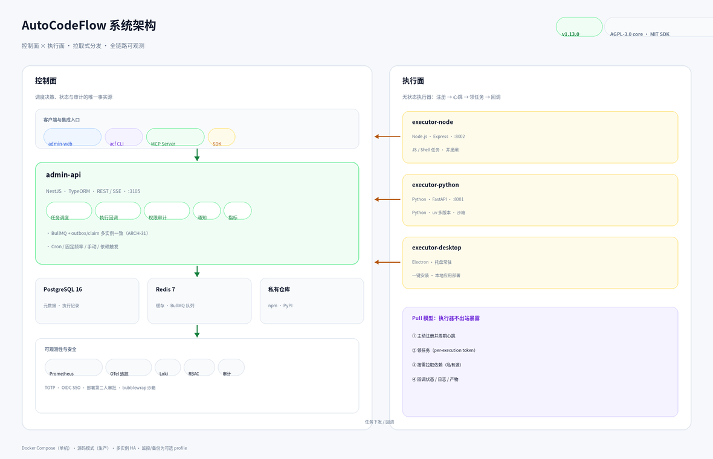
</p>

**控制面**（admin-api + admin-web + PostgreSQL + Redis）持有全部调度决策、状态与审计；
**执行面**（executor-node / executor-python / executor-desktop）无状态，主动注册、心跳、领任务、回调。

```
浏览器 / CLI / MCP / SDK
        │  REST + SSE
        ▼
┌──────────────────────────────────────────────┐
│ admin-api (NestJS, :3105)                    │
│  · 调度器：Cron / fixed-rate / DAG / 手动     │
│  · 回调接收 → 执行记录 / 日志分片 / 产物       │
│  · RBAC / API Key / 审计 / 通知分发           │
└───────┬──────────────────┬───────────────────┘
        │                  │
   PostgreSQL 16       Redis 7 + BullMQ
   （元数据/审计）      （队列/缓存/多实例协调）
        ▲
        │ 注册 / 心跳 / 领任务 / 回调（Pull）
        │
┌───────┴────────────┬───────────────────┬──────────────────┐
│ executor-node      │ executor-python   │ executor-desktop │
│ JS / Shell 任务    │ Python 任务       │ 桌面 / 本地自动化 │
│ :8002              │ :8001 · uv 多版本 │ Electron 托盘常驻 │
└────────────────────┴───────────────────┴──────────────────┘
        │ 按需拉取依赖
        ▼
 私有仓库：npm (Verdaccio) · PyPI
```

一次任务执行的完整链路：**创建任务 → 调度入队 → 执行器领取 → 拉取脚本/依赖 → 执行 → 回调状态/日志/产物 → 通知与 AI 分析**。
细化到每个模块的拆解见 [架构图谱（Atlas）](docs/atlas/README.md) 与 [ADR](docs/adr/README.md)。

## ✨ 核心能力

| 能力 | 说明 |
|---|---|
| **调度** | Cron（5 段表达式 + 时区）、固定频率、手动触发、Webhook 入站、任务依赖 DAG、维护窗口 |
| **执行策略** | 超时与超时预警、最大重试与可重试错误白名单、并发闸/互斥组、阻塞策略、misfire 策略、执行器亲和/反亲和标签 |
| **多执行器** | Node.js / Python / Electron 桌面三类执行器；自动注册、心跳保活、负载感知分发、多实例一致性（outbox + claim） |
| **脚本形态** | 内置 Glue 脚本（在线编辑、语法检查、AI 生成）、Git 仓库、应用 zip 包；私有 npm/PyPI 依赖安装 |
| **可观测** | SSE 实时日志、执行趋势与成功率、调度延迟、Prometheus 指标、OpenTelemetry 追踪、Loki 日志聚合 |
| **告警通知** | 企业微信、钉钉、Slack Webhook、SMTP 邮件；规则、静默期、HMAC 签名校验 |
| **安全** | RBAC（项目级角色）、作用域 API Key、TOTP 双因子、OIDC SSO、审计日志、部署第二人审批、Python 任务 bubblewrap 沙箱 |
| **AI** | OpenAI / Ollama / Qwen：脚本生成、失败根因分析、调度建议、应用健康分析；MCP Server 让 Agent 直接管理任务 |
| **交付** | `acf` CLI（67 个子命令）、Node/Python 双 SDK、MCP Server（56 个工具）、VitePress 文档站 |

## 🚀 快速开始

### 方式一：Docker Compose（推荐试跑）

```bash
git clone https://github.com/LuluDeer/AutoCodeFlow.git
cd AutoCodeFlow

cp .env.example .env
# 必改：INITIAL_ADMIN_PASSWORD（>= 8 位，弱口令会被启动校验拒绝）
#      POSTGRES_PASSWORD / JWT_SECRET / JWT_REFRESH_SECRET / EXECUTOR_SECRET
vim .env

docker compose up -d
docker compose ps          # 全部 healthy 即启动完成
```

打开 **http://localhost**，用 `.env` 中的管理员账号登录。首次登录后请立即修改密码。

### 方式二：一键部署脚本（生产）

`deploy.sh` 支持**源码模式**与 **Docker 模式**，8 阶段流水线：
预检 → 配置 → 依赖 → 构建 → 基础设施 → 迁移（自动备份）→ 启动 → 验证。

```bash
sudo ./deploy.sh --mode source --env production --i-know-its-production   # 生产源码部署
./deploy.sh --mode docker --env staging --build                          # 试跑环境
./deploy.sh doctor                                                       # 部署前体检
./deploy.sh doctor --json                                                # 结构化体检（Agent 可用）
```

### 方式三：本地开发

```bash
make infra-up                                  # 仅启动 PostgreSQL + Redis
make install                                   # 安装全部依赖
cd apps/admin-api && npm run migration:run && cd ../..
make dev                                       # admin-api + admin-web + 两个执行器
```

### 造一套演示数据

```bash
make demo-seed    # 注入 demo- 前缀的任务、执行记录与 SOP（需 admin-api 已启动）
```

### 访问地址

| 服务 | 地址 | 说明 |
|---|---|---|
| 管理后台 | http://localhost | admin-web（生产由 nginx 托管） |
| API 文档 | http://localhost:3105/api/docs | Swagger / OpenAPI |
| 健康检查 | http://localhost:3105/api/health/live · `/api/health/ready` | 存活 / 就绪 |
| Prometheus 指标 | http://localhost:3105/api/metrics | 需 JWT；可用 `METRICS_PROMETHEUS_ENABLED=false` 关闭 |
| npm 私有仓库 | http://localhost/npm/ | Verdaccio |
| PyPI 私有仓库 | http://localhost/pypi/ | 自建 FastAPI 私服 |
| 执行器 | :8001（python）· :8002（node） | 默认仅绑定 127.0.0.1 |

> 监控栈为可选 profile：`docker compose --profile monitoring up -d`
> （Prometheus :9090 · Grafana :3000 · Alertmanager :9093 · Loki :3100）；追踪 `--profile jaeger`（Jaeger UI :16686）；
> 备份 `--profile backup`；对象存储 `--profile minio`；数据库副本 `--profile replica`。

## 🛠️ 客户端与集成

### CLI（`acf`）

```bash
npm install -g @autocodeflow/cli

acf login --url http://localhost:3105 --user admin        # 交互式登录（支持 TOTP）
acf task list                                             # 任务列表
acf task trigger <taskId> --wait                          # 触发并等待终态（失败退出码 1）
acf task logs <execId> --tail 200                         # 拉取执行日志
acf executor list                                         # 执行器列表
acf app deploy <appId> --executor <id>                    # 部署应用到执行器
```

CI 场景推荐用环境变量注入凭证（不落盘）：`ACF_API_URL` / `ACF_TOKEN`。
完整命令地图见 [CLI 命令地图](docs/atlas/05-interfaces/cli.md)。

### SDK

```bash
npm install @autocodeflow/sdk     # Node.js
pip install autoflow-sdk          # Python
```

任务内可直接使用 `ctx`：读参数、发 HTTP 请求、上报日志与结果。

```js
// Node.js —— 随任务下发的 Glue 脚本
const res = await ctx.http.get('/api/tasks?pageSize=5');
ctx.logger.info('tasks fetched', { meta: { count: res.list.length } });
return ctx.success('done', { count: res.list.length });
```

```python
# Python —— 随任务下发的 Glue 脚本
rows = load_rows()                      # 你的业务代码
ctx.log.info("rows=%d", len(rows))
ctx.report_success(summary="etl done", duration_ms=412)
```

能力对照与差异裁定见 [SDK 指南](docs/sdk-guide.md)，可运行示例见 [examples/](examples/README.md)。

### MCP Server（AI Agent 集成）

```json
{
  "mcpServers": {
    "autocodeflow": {
      "command": "npx",
      "args": ["-y", "autocodeflow-mcp-server"],
      "env": {
        "AUTOCODEFLOW_API_URL": "http://localhost:3105",
        "AUTOCODEFLOW_API_TOKEN": "<your-jwt-token>"
      }
    }
  }
}
```

56 个工具覆盖任务、执行、执行器、应用部署、SOP、审计与审批；权限由 JWT 角色在服务端强制。
详见 [packages/mcp-server/README.md](packages/mcp-server/README.md)。

## 📦 技术栈

| 层 | 技术 |
|---|---|
| **控制面** | NestJS · TypeORM · PostgreSQL 16 · Redis 7 · BullMQ |
| **管理台** | React 19 · Vite · Ant Design · TypeScript · Recharts |
| **执行器** | Node.js 24（Express）· Python 3.12（FastAPI）· Electron |
| **私有仓库** | Verdaccio（npm）· 自建 FastAPI（PyPI） |
| **CLI / SDK / MCP** | Commander.js · axios / httpx · MCP SDK |
| **可观测** | Prometheus · Grafana · Loki · OpenTelemetry · Alertmanager |
| **部署** | Docker Compose · 源码模式（systemd + nginx）· 多实例 HA |

## 🗂️ 仓库结构

```
AutoCodeFlow/
├── apps/
│   ├── admin-api/         控制面后端（REST + SSE + 调度 + 审计）
│   ├── admin-web/         管理台 SPA
│   ├── executor-node/     Node.js 执行器（:8002）
│   ├── executor-python/   Python 执行器（:8001，uv 多版本）
│   ├── executor-desktop/  Electron 桌面执行器（托盘常驻）
│   ├── registry-npm/      私有 npm 仓库（Verdaccio 配置）
│   └── registry-pypi/     私有 PyPI 仓库（FastAPI）
├── packages/
│   ├── acf-cli/           acf 命令行工具
│   ├── mcp-server/        MCP Server（AI Agent 集成）
│   ├── autocodeflow-node-sdk/  Node.js SDK
│   ├── autoflow-sdk/      Python SDK
│   ├── executor-protocol/ 执行器协议契约
│   └── docs-site/         VitePress 文档站
├── docs/                  文档（入口：docs/README.md）· 展示图：docs/assets/
├── examples/              可运行的官方示例
├── infra/                 反向代理、监控、基础设施 compose
├── scripts/               构建、校验、自检与守卫脚本
└── deploy.sh              一键部署（源码 / Docker 双模）
```

根目录只放仓库级文件（README / LICENSE / CHANGELOG / CONTRIBUTING / SECURITY / 部署脚本与 compose），
其余文档一律进 [`docs/`](docs/README.md)，一次性报告进 [`docs/archive/`](docs/archive/README.md)——
由 CI 的 `DOC-GOV` 守卫（`scripts/docs/check-docs.mjs`：死链 / 孤儿文档 / 根目录洁癖）强制执行。

## 📚 文档

| 文档 | 说明 |
|---|---|
| [**文档中心**](docs/README.md) | **从这里开始**——按角色索引全部文档 |
| [快速上手](docs/quickstart.md) | 5 分钟跑通第一条定时任务 |
| [部署指南](docs/deployment.md) | 系统要求、环境变量、升级与回滚 |
| [运维手册](docs/operations.md) | 日常运维、备份恢复、扩容、故障排查 |
| [开发指南](docs/development.md) | 本地开发、测试、代码规范 |
| [SDK 指南](docs/sdk-guide.md) | Node / Python 双 SDK 能力矩阵与用法 |
| [API 参考](docs/api-reference.md) | REST 端点契约、认证、错误码 |
| [架构图谱](docs/atlas/README.md) | 全项目结构 / 功能 / 关系彻底拆解 |
| [教程](docs/tutorials/index.md) | 按真实上线顺序编排的五篇教程 |
| [架构决策记录](docs/adr/README.md) | 改架构前必读的 ADR |
| [可观测性](docs/observability/README.md) | 指标、日志、追踪与告警配置 |
| [获取帮助](SUPPORT.md) · [安全策略](SECURITY.md) | 去哪提问、如何报告漏洞 |

## 🔒 安全

- **RBAC** — 项目级角色（owner / developer / viewer），路由级门控与 CI 守卫（`check-route-authz-matrix`）。
- **凭证** — 作用域 API Key、per-execution 回调令牌、执行器共享令牌轮换、TOTP 双因子、OIDC SSO。
- **隔离** — Python 任务可选 bubblewrap 沙箱（用户命名空间 + 只读根 + PrivateTmp）；子进程环境变量白名单。
- **网络** — 出站请求统一 SSRF 守卫 + DNS pin（私网默认拒绝，按集成按需开启）。
- **审计** — 全量操作审计日志、部署第二人审批、可回溯的配置历史。
- **供应链** — 依赖审计日志、密钥扫描（gitleaks）、镜像多架构构建闸、发布卫生审计。

安全漏洞请按 [SECURITY.md](SECURITY.md) 私下报告，不要开公开 issue。

## 🤝 贡献

1. Fork 本仓库并创建分支：`git checkout -b feat/your-feature`
2. 遵循 [Conventional Commits](https://www.conventionalcommits.org/) 提交
3. 跑对应测试（`npm run test:api` / `test:web` / `test:python` …）
4. 提交 PR 并填写检查清单（见 [CONTRIBUTING.md](CONTRIBUTING.md)）

CI 覆盖 admin-api、admin-web、三类执行器、双 SDK、CLI、MCP Server、部署脚本与文档守卫。

## 📄 许可证

AutoCodeFlow 自 v1.4.0 起采用**分组件许可**：

| 组件 | 许可证 |
|---|---|
| **平台核心**（`apps/*` + `packages/docs-site`） | [AGPL-3.0-only](LICENSE) |
| **客户端 SDK 与工具**（CLI、Node/Python SDK、MCP Server） | MIT |
| **执行器协议**（第三方执行器集成） | MIT |

v1.3.0 及更早版本继续以 MIT 提供。

## 🙏 致谢

[NestJS](https://nestjs.com/) · [React](https://react.dev/) · [Ant Design](https://ant.design/) ·
[TypeORM](https://typeorm.io/) · [BullMQ](https://docs.bullmq.io/) · [Electron](https://www.electronjs.org/) ·
[Vite](https://vite.dev/) · [FastAPI](https://fastapi.tiangolo.com/) · [Verdaccio](https://verdaccio.org/)

---

<p align="center"><sub>© 2026 LuluDeer · 用 ❤️ 与 TypeScript / Python 构建</sub></p>
