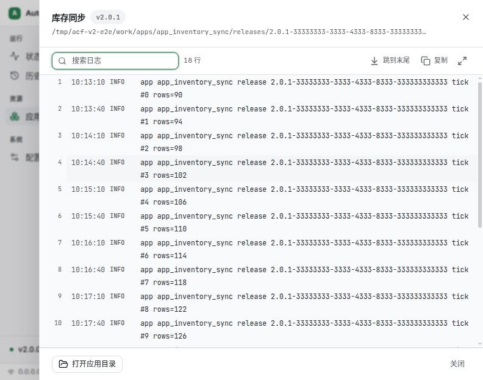
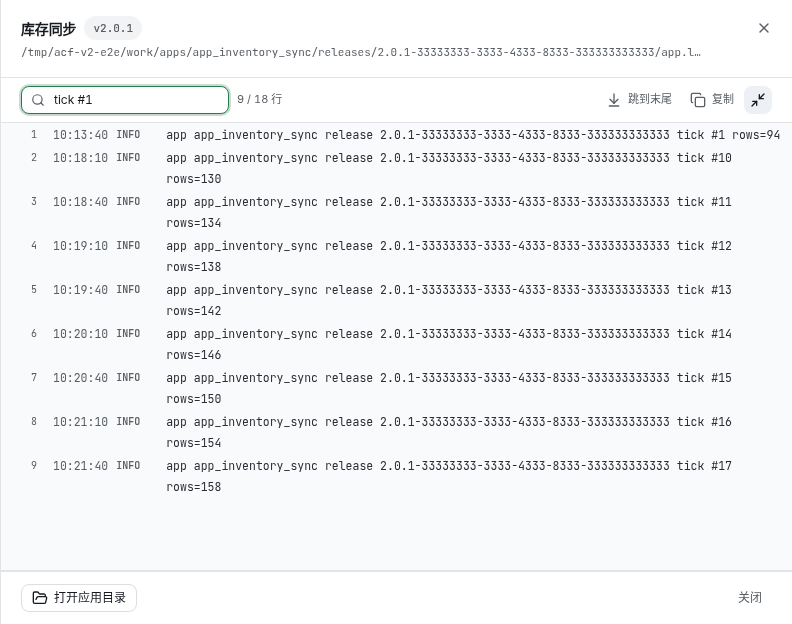
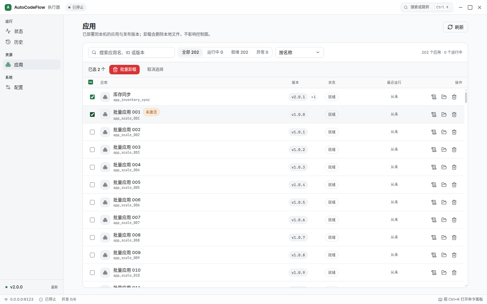
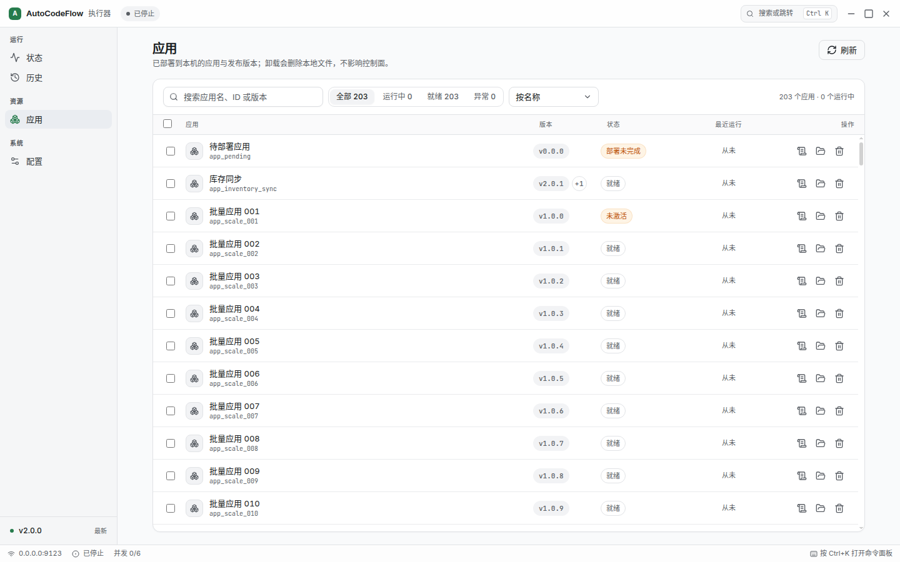
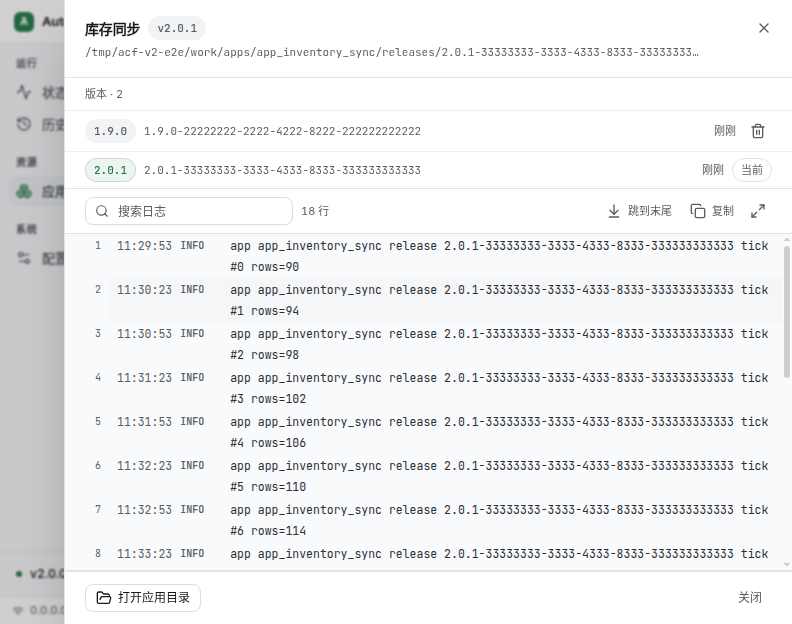
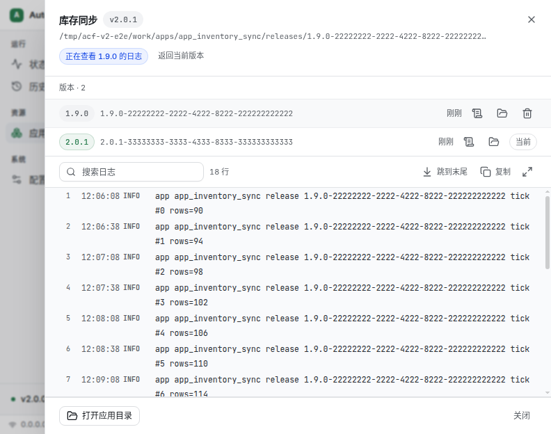
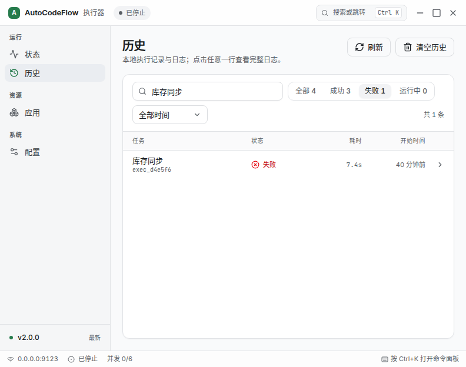

# Executor Desktop V2 — Phase 0 设计打样

> 状态：**设计验证中**，尚未接入真实 IPC，也未决定壳层（Electron / Tauri）。
> 目标：先用真实组件库证明「视觉与交互可以到什么程度」，再决定迁移范围。

## 为什么有这个目录

V1（`apps/executor-desktop`）是手写 CSS：`styles/pages.css` 2,403 行、`components.css` 848 行，
页面级覆盖占 63%，缺一层「有行为、有变体、有令牌」的原语组件。V2 换思路：

- **令牌即代码**：颜色/字号/圆角/动效写在 `src/styles.css` 的 `@theme` 里，页面不再写裸 px；
- **原语先于页面**：Button / Input / Select / Dialog / Tabs / Switch / Tooltip / Command 全部来自
  Radix + shadcn 约定，键盘、焦点、弹层定位由库负责；
- **组件画廊是视觉合同**：`/gallery` 并排展示所有状态，改样式先看画廊；
- **壳无关**：同一份 `dist/` 既能跑 Electron，也能交给 Tauri 的 webview。

## 运行

```bash
cd apps/executor-desktop-v2
npm install --cache ./.npm-cache   # 本机 ~/.npm-cache 有 root 残留，故用局部缓存
npm run dev                        # http://127.0.0.1:5273
npm run build                      # 产物 dist/
```

## 已覆盖

| 区域 | 内容 |
|---|---|
| 壳层 | 自定义标题栏（拖拽区 + 窗控已接 bridge）、可折叠侧栏（<768px 变 52px 图标栏）、状态栏 |
| IPC adapter | `src/lib/ipc.ts`：类型化接口 + Electron 真桥 + 浏览器 mock（localStorage 持久化） |
| 状态页 | 接 bridge：真实 PID / 启动时刻（运行时长）/ 版本 / 最近心跳、日志初始载入 + 实时流、级别筛选/暂停/复制/清空、KPI 由本地记录实时计算、启动/停止/重启 |
| 配置页 | 5 个分区（连接与身份 / 网络地址 / Python 运行环境 / Agent / 关于与更新）、连通性与端口探测、运行时诊断、脏字段计数与保存条、RHF 表单校验 |
| 历史页 | 搜索 + 状态/时间筛选、48px 行高表格、详情抽屉（元信息 + 虚拟化日志 200+ 行）、复制/导出/定位日志、清空确认 |
| 应用页 | 卡片清单按应用归并（V1 是每个 release 一条）、运行中/就绪/异常三态、版本数徽标、日志抽屉、打开应用目录、卸载二次确认 |
| 运行向导 | 五步（欢迎 / 连接 / 执行器 / 解释器源 / 完成），逐步校验、上一步、连通性与端口探测、保存后可选立即启动 |
| 命令面板 | Ctrl/Cmd+K，跨页跳转 + 初始化向导 / 重启执行器 / 导出诊断（真实动作） |
| 组件画廊 | 按钮/徽章/表单/开关/分段/进度/弹层/Toast/表格/骨架/空态/排版刻度 |

## 还没做（Phase 1 剩余）

- 打包签名与 CI 流水线（本地脚本已就绪，尚未接 GitHub Actions）；
- i18n 词表接入（复用 V1 的 `i18n.ts` 键）；
- 截图快照进 CI（复用 V1 的 Playwright 视觉用例）；
- 路由级 code split（当前单 chunk > 500KB）。

## 截图

`src` 之外的 `screenshots/` 保留了各页 1440 / 900 两档视觉基线，改动后重跑
`node ../executor-desktop/scripts`（或复用 V1 的 Playwright）即可对比。

## 设计约束（硬规则）

1. 字号只用 11/12/13/14/16/20/24/32；UI 正文 13px。
2. 间距只用 4 的倍数；控件高 32，行高 32。
3. 边框 1px 中性色；不出现纯黑纯白；阴影只在弹层与卡片用两级。
4. 圆角：控件 8、卡片 10、弹层 12。
5. 动效 120–200ms，`--ease-standard`；尊重 `prefers-reduced-motion`。
6. 状态色只表达结果（绿=成功、蓝=运行、红=失败、琥珀=等待），标识态用中性色。
7. 每个列表必须有空态、骨架、错误态。
8. 页面内不写新的颜色/字号字面量——只能引用令牌。

## 在真实 Electron 壳里联调

```bash
cd apps/executor-desktop
npm run dev:v2
```

脚本会依次：构建 V2 → 准备隔离 userData（含 4 条执行历史）→ 构建 V1 主进程 →
起 V2 静态服务 → 以 `ACF_RENDERER_URL` 启动 Electron。主进程的 preload 桥、
IPC sender 闸、导航守卫全部走真实实现，**默认启动路径不受影响**（不设该变量时
仍然加载 `dist/renderer/index.html`）。

2026-10 在 Electron 44.4.5 / Linux 上验证过的链路：

| 链路 | 结果 |
|---|---|
| `config:get` | 返回隔离配置（`executor-v2-harness` / `9123` / workDir 指向 seed 目录） |
| `executor:status` | 返回 `stopped`，V2 标题栏与状态栏同步为「离线」 |
| `history:get` | 返回 4 条 meta；V2 正确渲染任务名、状态、耗时（`endTime - startTime`）与相对时间 |
| 配置页读回 | 输入框显示 seed 的地址与名称 |

真壳截图见 `screenshots/electron-status-1440.png` / `electron-history-1440.png` /
`electron-config-1440.png`。相关改动：
`apps/executor-desktop/src/main/window-manager.ts`（`rendererBaseUrl`）与
`ipc-handlers.ts`（sender 闸同源放行）。

注意：

- Linux 非 root 环境下 Electron 的 SUID sandbox 不可用，脚本默认追加
  `--no-sandbox`（可用 `ACF_ELECTRON_SANDBOX=1` 关掉该默认）；打包产物不受影响。
- 真实主窗路径：`ACF_OPEN_STATUS=1`（**仅未打包时生效**）让 V1 启动即打开主状态窗，
  V2 从 `#status` 进入；打包产物忽略该变量，不会变成隐藏入口。

## Tauri POC

`apps/executor-desktop-tauri/` 用 Tauri 2 加载同一份 `dist/` 做了可行性验证：
WebKitGTK 下 V2 能完整渲染（截图 `screenshots/tauri-poc.png`），但不含 IPC/托盘/
更新器/sidecar，**不可发布**。构建方式与结论见该目录 README；CI 为手动触发的
`tauri-poc` workflow。

## 工程化要点

- **按屏懒加载**：首屏 `index` 约 390KB（gzip 128KB），历史/应用/配置/画廊各自成
  chunk（配置 22KB、历史 10KB、状态 11KB），冷启动不再解析整包。
- **生产 CSP**：构建期注入 `default-src 'self'` 策略，样式允许内联（Radix 定位），
  脚本/字体/连接一律同源；dev 不注入，避免挡住 HMR。
- **组件画廊仅 dev 可见**：导航与命令面板都按 `import.meta.env.DEV` 过滤。
- **壳层状态一致**：标题栏与状态栏按 `online / pending / stopped / offline`
  四态显示，不再用布尔值糊成「在线/离线」。
- **日志解析兼容两种真实格式**：executor 的 `HH:MM:SS LEVEL msg` 与主进程
  logger 的 `[timestamp] [level] msg`，空行在载入时剔除。
- **i18n**：`src/lib/i18n.ts` 是类型化字典（zh/en 键必须一一对应，少翻一个直接编译失败），
  启动前按 `uiLanguage`/系统语言解析一次；壳层、状态、历史、应用、配置、向导均已覆盖，
  日期/相对时间/时长格式随语言切换。改语言保存后会重载窗口（与 V1 同口径，不做热切换）。

## 打包路径（file://，不依赖 dev server）

V2 产物复制到 `apps/executor-desktop/dist/renderer-v2/`，主进程按 `ACF_RENDERER=v2`
加载本地入口；`base: './'` 保证资源是相对路径。

```bash
cd apps/executor-desktop-v2 && npm run build
cd ../executor-desktop && npm run build:renderer-v2
ACF_OPEN_STATUS=1 \
ELECTRON_USER_DATA_DIR=/tmp/acf-v2-e2e \
  npx electron . --no-sandbox
```

2026-10 在 Electron 44.4.5 / Linux 上验证：

- URL：`file:///.../dist/renderer-v2/index.html#status`
- 页面标题与 `h1` 正常，`config:get` / `executor:status` 走真实 IPC
- 控制台 **0 error**（CSP 放行 `data:` 字体，脚本/样式/字体均同源）
- 缺 V2 产物时 `resolveRendererIndex()` 回退 V1 并落 warn，不会白屏
- `electron-builder.yml` 的 `files` 已包含 `dist/renderer-v2/**/*`

**2026-10 起 V2 是默认渲染层**；`ACF_RENDERER=v1` 是显式逃生门（回退旧 UI）。
首次启动时 V1 打开的 `#wizard` 窗口同样加载 V2 —— V2 识别 hash 后渲染
**独立向导**（无应用壳、无遮罩、自带拖拽条），保存走 `save-and-close-wizard`。
托盘菜单的 `switch-tab` 事件也已接上（主进程 → 渲染层切页）。

## 一条命令验收（真壳）

```bash
cd apps/executor-desktop-v2 && npm run build
cd ../executor-desktop && npm run build:renderer-v2
ACF_E2E_USER_DATA=/tmp/acf-v2-e2e npm run verify:v2
```

`verify:v2` 以 `file://` 启动 Electron，逐项断言：

```
PASS  default renderer is V2 (file://) — …/renderer-v2/index.html#status
PASS  status page rendered — 状态
PASS  preload bridge reachable
PASS  update API exposed by preload
PASS  config:get returns seeded config — executor-v2-harness:9123
PASS  executor:status returns a status — stopped
PASS  sidebar has production entries — 4 items
PASS  status attention opens filtered history — 历史 / 1 rows
PASS  history renders real records — 4 rows / 4 from IPC
PASS  apps list shows deployed apps — 2 个应用 · 库存同步 v2.0.1 2 个版本
PASS  apps grouped per app (2 cards / 3 releases) — 2 cards
PASS  app log drawer reads real log
PASS  uninstall deletes app directory
PASS  apps list refreshes after uninstall
PASS  bulk selection shows bar
PASS  bulk uninstall deletes remaining app
PASS  apps list empty after bulk uninstall — 0 rows
PASS  app detail lists all releases — 2 releases
PASS  delete release removes its directory
PASS  current release is kept
PASS  release log can be opened
PASS  release log has lines
PASS  history meta files present — 4 files
PASS  clear history deletes meta files — 4 -> 0
PASS  history list is empty after clear — 0 rows
PASS  config dirty bar appears
PASS  config save persists to disk — maxConcurrentTasks=5
PASS  restart brings a new executor process online — 971474 -> 971601
PASS  language switch reloads UI — Status
PASS  wizard follows english locale — Setup wizard
PASS  wizard shows local IP suggestions
PASS  wizard probes interpreter sources
PASS  english locale renders status — Status
PASS  english locale covers all pages — History / Settings
PASS  config form shows real config — ws://127.0.0.1:9123
PASS  tray switch-tab navigates — 历史
PASS  executor port is free before start
PASS  executor starts and listens on 9123
PASS  executor reaches online — {"running":true,"status":"online","pid":…}
PASS  status events include pending → online — pending,online
PASS  status page shows real pid/uptime — PID …
PASS  executor stops and releases port — {"running":false,"status":"stopped"}
PASS  no console errors
PASS  error boundary catches render crash
PASS  retry recovers from crash — 状态
PASS  first run opens #wizard window — …/renderer-v2/index.html#wizard
PASS  wizard window renders standalone UI — 初始化向导
PASS  wizard window closes after save
PASS  wizard persists config to disk — {configured:true,name:…,port:9123}
```

新增断言直接改 `apps/executor-desktop/scripts/verify-v2-shell.mjs`，非 0 退出码可进 CI。

## 壳侧增量（V1 main，向后兼容）

- `executor:status` 新增 `pid` / `startedAt` / `version` / `lastHeartbeatAt`，
  旧渲染层忽略即可；V2 状态页据此显示真实进程号、运行时长与心跳。
- `HeartbeatMonitor.getLastSuccessAt()`：本地/中台两个探针取较晚的成功时刻。

## 视觉回归（真壳像素比对）

```bash
cd apps/executor-desktop
npm run visual:v2          # 与基线比对，超过 0.2% 像素差异退出 1
npm run visual:v2:update   # 人工确认改动后重写基线
```

覆盖 5 个页面：`status / history / apps / config / wizard`，基线在
`apps/executor-desktop/e2e-v2/baseline/`。

稳定性来自三件事：

1. 每次运行重新 seed 隔离 userData（相对时间、条数、耗时都固定）；
2. 截图前注入 CSS 关闭动画/过渡/光标闪烁；
3. 状态页日志区用 `mask` 盖住（底色 `#f7f8fa`），既避开流动内容，又不破坏可读性。

同一提交连续两次运行实测 **0.000%** 差异；把基线里涂一块 160×60 的红色后，
脚本报 `FAIL status: 0.73% pixels differ` 并写出 `e2e-v2/diffs/status.diff.png`，
确认检测链路有效。

## 无障碍与键盘（真壳）

```bash
cd apps/executor-desktop && npm run a11y:v2
```

- axe-core（wcag2a + wcag2aa）跑 5 个页面 + 历史抽屉 / 清空确认框 / 命令面板 / 独立向导；
- 键盘断言：Esc 关闭并把焦点还给触发元素、Ctrl+K 打开命令面板；
- axe 通过 `page.evaluate` 注入（页面 CSP 禁止内联 `<script>`，DevTools 上下文不受限）。

这一轮修掉的问题：

| axe 规则 | 处理 |
|---|---|
| `aria-valid-attr-value` | 筛选器的 Radix Tabs 生成了指向不存在 panel 的 `aria-controls` → 换成 `Segmented`（`role=group` + `aria-pressed`） |
| `button-name` | 日志工具条的暂停/复制/清空按钮补 `aria-label`；时间范围 Select 补可访问名 |
| `aria-progressbar-name` | 并发进度条补 `aria-label` |
| `color-contrast` | 61 处 → 0：加深 `--muted-foreground`、去掉文字上的 `/60` `/70` 透明度、ammber/red 文本降到 700 档 |
| `scrollable-region-focusable` | 日志滚动区加 `tabIndex=0` + `role=region` + `aria-label` |

另外：对话框/抽屉关闭后焦点显式归还触发元素；新增 `prefers-reduced-motion` 全局降级。

## CI（GitHub Actions）

`.github/workflows/v2-verify.yml` 在 PR / push 命中 `apps/executor-desktop` 或
`apps/executor-desktop-v2` 时触发，流程与本地一致：

1. `npm ci`（两个包，lockfile 分列缓存键）；
2. 构建 V2 → `build:renderer-v2` → `build:main`；
3. seed 隔离 userData；
4. `dbus-run-session -- xvfb-run …` 下依次跑 `verify:v2` / `a11y:v2` / `visual:v2`；
5. 失败时上传 `screenshots/` 与 `e2e-v2/diffs/`。

注意：`apps/executor-desktop/e2e-v2/baseline/*.png` **必须提交**，否则 visual 会报
`missing baseline`。像素阈值可用 `VISUAL_THRESHOLD` 覆盖（默认 `0.002`）。

本机用同一套命令模拟过 CI（xvfb + dbus，无 WM）：

```
verify:v2   50/50 PASS
a11y:v2     13/13 PASS
visual:v2   5/5 PASS (0.000% diff, threshold 0.20%)
```

## 打包形态冒烟

```bash
cd apps/executor-desktop
npx electron-builder --linux dir --publish never
npm run verify:v2:packaged
```

```
PASS  packaged app exposes CDP
PASS  loads renderer from app.asar — …/app.asar/dist/renderer-v2/index.html#wizard
PASS  wizard window renders — 初始化向导
PASS  preload bridge works in packaged build — {"name":"executor-v2-harness","configured":false}
PASS  packaged executor sidecar starts
PASS  packaged executor sidecar stops
```

与 `verify:v2` 的区别：这里加载的是 **app.asar 内的 renderer-v2 / preload**，以及
`resources/` 下的 executor sidecar —— 覆盖 asar 路径、`extraResources` 布局与
`app.isPackaged` 分支。打包态刻意不提供 `ACF_OPEN_STATUS` 逃生门，所以用
「首次启动」形态（`configured=false` → `#wizard`）拿窗口。

`--dir` 出包不校验 `uv/`、`playwright/` 是否非空；发布流水线通过
`ACF_UV_REQUIRED` / `ACF_PLAYWRIGHT_REQUIRED` 把关。Linux 本机未安装 4755
`chrome-sandbox` 时脚本会自动加 `--no-sandbox`。

## 崩溃兜底与失败重试

- **错误边界**：`src/components/error-boundary.tsx` 分两级——`root` 兜整窗（壳层也挂了），
  `screen` 只替换内容区、保留侧栏与标题栏；提供「重试 / 重新加载 / 复制错误信息」。
  切页时用 `resetKey` 自动清空错误。
- **失败重试**：执行器启动/停止/重启失败时，状态页顶部出现 `role=alert` 横幅，
  带完整错误与「重试 / 关闭」；错误原文来自主进程（如端口被占用的具体原因）。
- **验收钩子**：设置 `localStorage['acf-v2-test-crash']='1'` 会让状态页渲染时抛错，
  `verify:v2` 用它断言边界与恢复路径（正常用户不会设置这个键）。

对应截图：`screenshots/verify-error-boundary.png`、`screenshots/verify-action-error.png`。

## 自动更新

配置页「关于与更新」里的状态机覆盖完整链路：

| 状态 | 界面 |
|---|---|
| idle | 「检查更新」按钮 |
| checking | 转圈，6s 无事件退回 `unavailable`（开发模式未启用 updater） |
| available | 版本号 + 更新内容 + 「下载更新」 |
| downloading | 进度条、百分比、已下载/总量、速率 |
| downloaded | 「已下载 x.y.z」徽标 + 「立即安装并重启」 |
| error | `role=alert` 错误条 + 重试 |

`updater:check` 只返回 `{ok}`，真正的结果由 `updater:available / progress / downloaded / error`
四个事件回推；`pending` 状态（`previouslyDownloaded`）会直接进入 downloaded。


浏览器 mock 里模拟了完整事件序列（每 120ms 推进 5%），所以上面两张图是不接网络也能复现的；
打包态的下载/安装走 electron-updater，安装前主进程还会原生二次确认。

## 应用页的真实数据验收

`seed-v2-harness.mjs` 现在会按 executor-node 的磁盘布局造两个应用：

```
<workDir>/apps/<appId>/
  app.json                      { appName, runMode }
  releases/<version>-<uuid>/app.log
  current -> releases/<当前版本>
```

其中「库存同步」有 2 个 release，用于验证**按应用归并**：V1 的 `apps:list` 是
「每个 release 一条」，V2 在 adapter 里按 `appId` 分组、优先 `current`、其次最近部署。

`verify:v2` 覆盖：

- 列表出现 2 个应用、库存同步显示「2 个版本」；
- 日志抽屉读到真实 `app.log`（18 行）；
- 卸载（原生确认框在主进程打桩为「继续」）→ 目录被删除 → 列表刷新。

顺带修了一个真实缺陷：V1 的 `apps:log:read` 返回 `{ lines, totalLines }`，adapter
之前只认纯数组/`content`，导致抽屉显示「0 行」。

## 写操作验收

除读取链路外，`verify:v2` 现在也覆盖两处真实写操作：

- **配置保存**：配置页把「最大并发任务」改成 5 → 出现「1 处未保存」→ 点保存 →
  读回 `config.json`，确认 `maxConcurrentTasks === 5`；
- **清空历史**：主进程原生确认框在无头环境无法点击，脚本用
  `electronApp.evaluate` 把 `dialog.showMessageBox` 打桩为「继续」→ 点击清空 →
  断言 `workDir/meta` 下 4 个 JSON 全部删除、列表回到空态。

`verify:v2` 每次启动前会重新 seed，所以「卸载应用」「清空历史」这类破坏性断言
可以反复运行，不会污染下一次验收。

## 发行产物（AppImage）冒烟

```bash
cd apps/executor-desktop
npx electron-builder --linux AppImage --publish never
# → dist-electron/AutoCodeFlow-Executor-2.0.0.AppImage（233 MB）

# 无 FUSE 的环境先解包，再用解包后的二进制跑同一套冒烟
cd dist-electron
./AutoCodeFlow-Executor-2.0.0.AppImage --appimage-extract
cd ..
ACF_PACKAGED_BINARY="$PWD/dist-electron/squashfs-root/executor-desktop" npm run verify:v2:packaged
```

```
PASS  packaged app exposes CDP
PASS  loads renderer from app.asar — …/squashfs-root/resources/app.asar/dist/renderer-v2/index.html#wizard
PASS  wizard window renders — 初始化向导
PASS  preload bridge works in packaged build
PASS  packaged executor sidecar starts
PASS  packaged executor sidecar stops
```

`--dir` 只验证 asar 布局，AppImage 额外覆盖了打包器、桌面入口、运行时挂载；
解包后的二进制与 AppImage 内容一致，所以无 FUSE 的 CI 也能验。

顺带修掉 electron-builder 的 Linux 警告：`package.json` 增加 `desktopName`、
`electron-builder.yml` 增加 `linux.syncDesktopName: true`，让 `.desktop` 的
`StartupWMClass` 与 Electron 实际 WM_CLASS 对齐（任务栏归组）。

## 已知边界（发布前必读）

1. **打包平台**：仅在 Linux（Ubuntu 24.04）验证了 `--dir` 与 AppImage；Windows NSIS /
   macOS dmg 未在本机构建。`electron-builder.yml` 已配置双平台，但需要对应 runner。
2. **自动更新**：UI 状态机与事件链路可用 mock 完整复现；真实下载/安装需要发布源与签名，
   本地只验证到「开发模式无事件 → 6s 后提示未启用」。
3. **AppImage 运行**：需要 FUSE；无 FUSE 时用 `--appimage-extract` 后运行解包二进制
   （验收脚本即走这条路径）。
4. **V1 渲染层仍在**：`ACF_RENDERER=v1` 可回退；`dist/renderer/` 随包分发，直到确认
   V2 无回退需求后再删除。
5. **视觉基线**：像素比对对环境字体敏感，CI 必须装 `fonts-noto-cjk`；跨 runner 的
   亚像素差异可用 `VISUAL_THRESHOLD` 调整（默认 0.2%）。
6. **外部程序调用**：「打开应用目录 / 在文件夹中显示」依赖系统文件管理器，未做自动断言。
7. **Tauri POC**：只证明渲染层可复用；不含 IPC/托盘/更新器/sidecar，不可发布。
8. **端口约定**：`verify:v2` 使用固定端口 9123 与隔离 userData；本机运行前确保该端口空闲。

## 规模与信息密度

面向「部署几十到几百个应用」的真实场景重新排过：

- **应用页**：卡片网格 → 52px 行高的表格（应用 / 版本+release 数 / 状态 / 最近运行 / 操作），
  TanStack Virtual 只渲染可视区。202 个应用实测 **25 个 DOM 行**，滚动到第 200 个仍流畅；
  支持搜索、状态筛选、名称/最近运行/安装时间排序；同一 `appId` 的多 release 归并为一行。
  截图：`screenshots/apps-scale-200.png`。
- **历史页**：行列表虚拟化，500 条记录也只渲染可视区；工具栏/表头固定。
- **状态页**：改为视口内布局 —— 右侧固定 340px、日志占剩余高度，不再出现「日志很长但只占半屏、
  下方一大片空白」；右栏补了「需要关注」（24h 内的失败任务），三张卡撑满高度。
  实时日志也复用 `LogPanel`（级别筛选 + 搜索 + 跳到末尾 + 复制 + 暂停/清空），
  截图：`screenshots/status-log-unified.png`。
- 宽屏/窄屏：`md` 以下应用表隐藏状态与最近运行列，只留应用/版本/操作；状态页在 `xl` 以下
  回到文档流（可整页滚动），不会硬塞两栏。

规模数据可以本地复现：

```bash
cd apps/executor-desktop
ACF_SEED_APP_COUNT=200 node scripts/seed-v2-harness.mjs /tmp/acf-scale
ACF_OPEN_STATUS=1 ELECTRON_USER_DATA_DIR=/tmp/acf-scale npx electron . --no-sandbox
```

## 日志排查面板

应用日志与执行日志共用 `LogPanel`，按“排查问题”而不是“看几行”来设计：

- 默认宽度 `min(1120px, 100vw - 64px)`，右上角「放大」可铺满窗口，再点还原；
- 日志内搜索（实时过滤，显示 `匹配 / 总数`），**行号保持日志文件里的真实行号**；
  超过 5000 行时只先渲染尾部 5000 行，可点「显示全部」放开；搜索走 `useDeferredValue`，
  几十万行下输入不阻塞；
- 「跳到末尾」「复制」、按需注入「导出 / 打开文件夹」；
- 长行自动换行，虚拟列表改为 `measureElement` 动态行高，避免换行叠字；
- 行号 + 级别着色 + 行内 hover，保留等宽字体。





已知取舍：小窗口（如 800×600）下右下角 toast 可能短暂盖住配置页底部保存条；
验收脚本会等 toast 消失再点保存，产品上后续可以把保存条抬到 toast 之上。

表格已补 `role=table / rowgroup / row / columnheader / cell` 与 `aria-rowcount` /
`aria-rowindex`；虚拟滚动下读屏仍能报出行号。加载与空态用单行 `role=row` + `cell[aria-colspan]`
承载，避免出现“没有 row 的 table”。

## 批量操作与部署状态

- 表格左侧新增勾选列，表头支持全选/半选（`indeterminate`）；搜索或筛选变化会清空选择，
  避免批量操作命中看不见的行。
- 选中后出现操作条：`已选 N 个` + 「批量卸载」+ 「取消选择」。
- 批量卸载新增主进程通道 `apps:uninstall-many`（preload → `uninstallApps`）：**只弹一次**
  原生确认，逐个复用 `uninstallApp`（含 appId 白名单、containment、executor 停机路径），
  最多 100 个/批，返回逐项结果。UI 汇总成功/失败并刷新列表。
- 部署状态：`current` 缺失的 release 在状态列显示「未激活」，悬停解释原因（部署未完成或
  被手工删除），不再和「就绪」混淆。



## 部署状态语义

| 状态 | 判据 | 展示 |
|---|---|---|
| 就绪 / 运行中 / 异常 | `apps:list` 的运行与 status | 原有徽章 |
| **部署未完成** | 没有任何已完成的 release（`releaseKey === ''`） | 状态列「部署未完成」+ 悬停说明 |
| **未激活** | 有 release，但没有 `current` 指向它 | 状态列「未激活」 |
| **无日志** | `hasLog === false` | 日志抽屉顶部说明；`scheduled` 模式会额外解释“只部署不启动” |



“部署失败”没有独立信号可用：inventory 只给 `current` / `hasLog`，失败后通常表现为
“没有任何 release”或“有 release 但无 current”，因此分别归入上面两档并给出原因提示。

## 应用详情与版本管理

应用日志抽屉顶部新增版本列表（按部署时间倒序）：

- 每个 release 显示版本号、releaseKey、部署时间；
- `current` 指向的版本标「当前」，不提供删除；
- 非当前版本可以单独删除（复用 V1 的 `apps:delete-release`：原生确认 + 运行中版本保守拒绝）；
- 每个 release 都能「查看该版本日志」（切到该版本 app.log，顶部提示 + 一键返回当前版本）
  和「打开该版本目录」（`apps:open-release-folder`）。





注意：V1 的 `apps:delete-release` 会先问执行器的 `/api/app-status` 判断版本是否在运行；
**执行器未响应时一律拒绝删除**（保守侧）。因此验收里会临时拉起执行器再删版本；
seed 配置也补了共享令牌，否则 `/api/*` 会 fail-closed 503。

### 状态页日志与全局日志面板统一

状态页原先自己渲染一份不可搜索、无行号的列表；现在和 App/执行日志共用 `LogPanel`：

- 级别筛选（全部/INFO/WARN/ERROR）通过 `toolbarStart` 插槽注入；
- 暂停/清空通过 `toolbarEnd` 插槽注入，暂停时关闭自动跟随；
- 搜索、跳到末尾、复制（复制的是**当前过滤结果**）由面板统一提供；
- 行号在状态页关闭（流式日志没有文件行语义），在应用/执行日志开启；
- 日志解析统一收口到 `lib/log-parse.ts`：支持 `HH:mm:ss LEVEL`、executor 的
  `YYYY-MM-DD HH:mm:ss.SSS [LEVEL]`、主进程的 `[timestamp] [level]` 以及 JSON 行；
  `npm run test:log-parse` 覆盖 7 种真实格式（verify:v2 会先跑它）。

视觉回归脚本的遮罩选择器同步改成 `[data-log-viewport]`，避免把流动的日志内容算进像素基线。

## 跨页跳转

- 状态页「需要关注」的每一条失败任务 → 历史页，自动带上「失败 + 任务名」筛选；
- 「最近任务 · 全部」→ 历史页（全部）；
- 执行器卡「详情」→ 配置页；
- 普通导航（侧栏 / 托盘 / Ctrl+2）到历史会清空上次的筛选意图，避免筛选条件粘住。



## 向导补齐（相对 V1）

- **执行器步**：新增「对外地址」，并列出本机网卡地址；进入该步时自动填 `<ip>:<port>`，可点选切换。
- **解释器源步**：进入即并行探测官方源与 TUNA 镜像，显示可达性与耗时；官方不可达且镜像可达时自动改选镜像，仍可手动改。
- **完成步**：新增「开机自动启动」，并把「保存后立即启动」落到 `autoStartExecutor`；保存时同步写入系统自启项。
- 校验：`verify:v2` 增加本机网卡、源探测两项断言。

## 应用多版本

版本数 > 3 时默认折叠为「版本 · N」+ 当前版本徽章，点开后在面板内滚动（`max-h-56`），
日志区保持固定高度；版本少时仍默认展开。避免几十个历史版本把日志挤没。

## 状态页日志高度

窗口宽度不足 `xl` 时，日志卡高度固定为 `min(60vh, 560px)`，日志在卡内滚动；
此前文档流会把日志撑到 1700px+，最后一屏压到状态栏下面，看起来像“INFO 溢出”。
`xl` 及以上仍是右侧 340px + 日志占满剩余高度。
