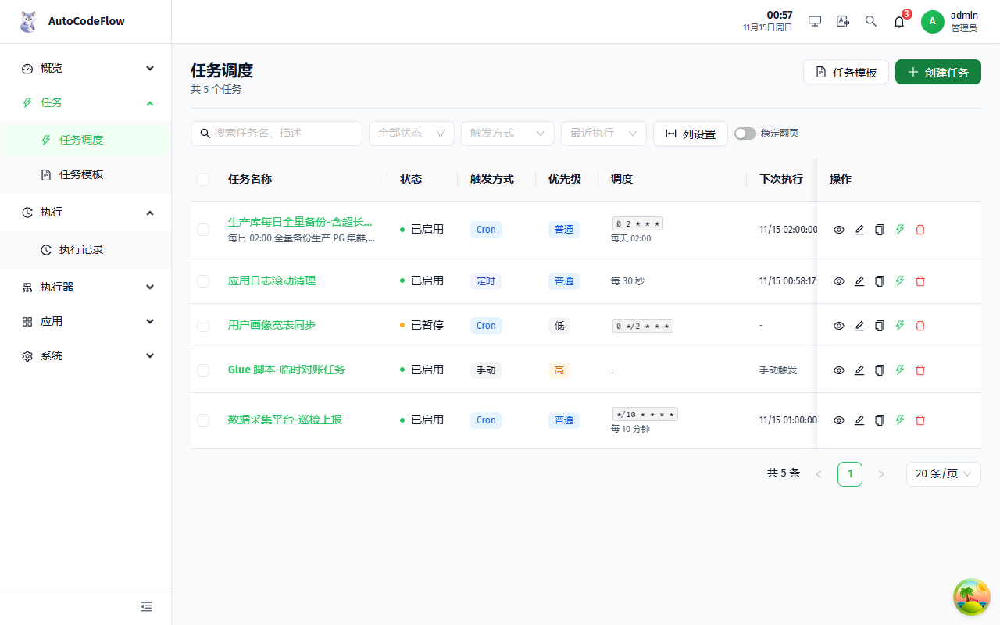
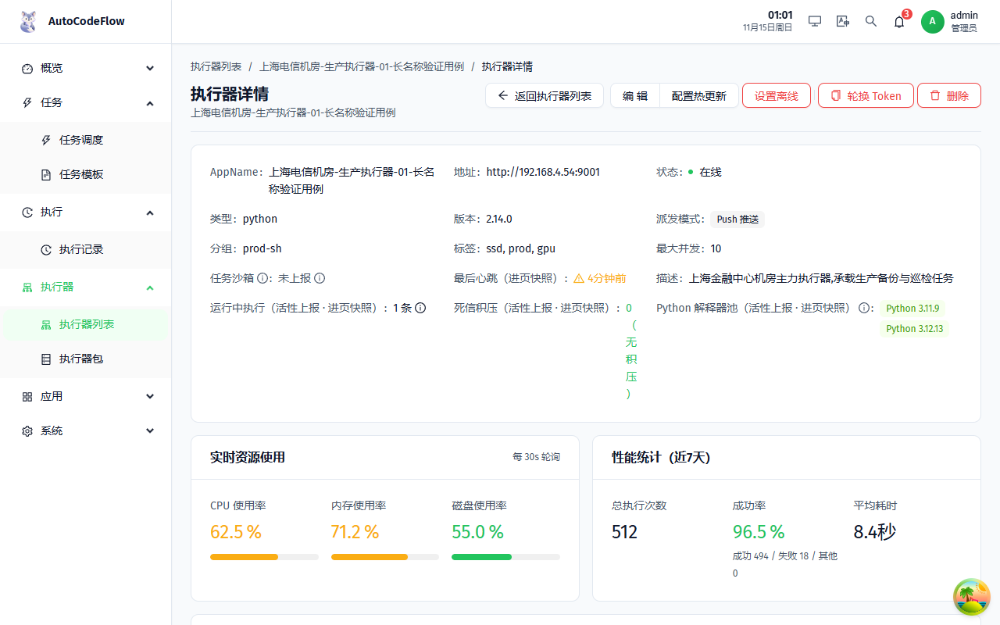
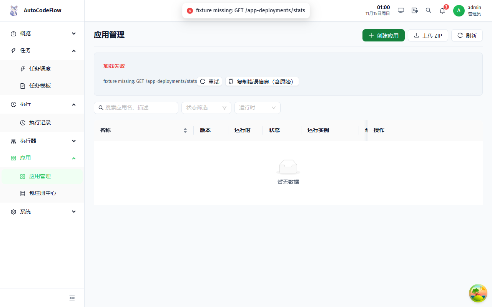

# AutoCodeFlow 产品与 UI 评审报告

- 评审日期：2026-11-15
- 评审对象：AutoCodeFlow 仓库 2.1.1（apps/admin-web、apps/admin-api、apps/executor-desktop）
- 评审视角：项目负责人 / 产品与运营工作台
- 评审方式：真实 Chromium 逐页走查（375 / 600 / 1280 / 暗色）+ 官方桌面端截图目检 + OpenAPI / CodeGraph 1.6.2 能力面交叉核对
- 评审边界：以“实际功能闭环与页面设计”为主，不以代码测试覆盖率作为结论依据；测试与实现细节只作为证据
- 结论概览：**未发现阻断级 P0；P1 9 项、P2 16 项、P3 10 项**

---

## 0. 核心判断

**AutoCodeFlow 已经是一台合格的“执行引擎”，但还不是一个合格的“运维驾驶舱”。**

后端能力明显跑在前面：调度、执行、SSE 日志、审批、审计、项目角色、AI 分析、MCP/CLI 都已具备；但控制台仍按“实体管理后台”组织——任务、执行器、应用各管一摊，而不是按值班场景组织：**发现异常 → 定位原因 → 处置 → 复盘**。这导致四类断裂：

1. **发现断裂**：任务列表在 1280 首屏看不到“上次执行结果/启用状态”，Dashboard 的成功率卡片里画的其实是执行量趋势，漏跑与 SLA 没有入口。
2. **定位断裂**：任务/执行列表筛选维度远少于后端能力，执行失败分布只统计当前页，产物没有跨执行的聚合入口。
3. **处置断裂**：审批待办、异常接管、任务/模板导入都只有分散入口或只有 API/CLI；详情页危险动作与普通动作同权重。
4. **复盘断裂**：产物库不可聚合检索，审计动作码裸露，项目维度无法回看。

如果只修一件事：**把“任务列表 + 项目上下文 + 待办收件箱”做成一个可按项目切换的值班首页**。它同时解决发现、定位、处置三条断裂。

---

## 1. 逐页结论

| 页面 / 视图 | 结论 | 主要观察 |
|---|---|---|
| 登录 | 基本可用，需修口径 | 页脚仍写 `v1.0`，与仓库 2.1.1 不一致；SSO 按钮按 OIDC 开关正常显隐 |
| 控制台 Dashboard | 需重做信息优先级 | 成功率卡片内混入无标签的执行量折线；平均耗时只有均值；失败列表在首屏之下；副标题与 SSE 实时机制矛盾 |
| 任务调度列表 | **需重做（P1）** | `scroll.x=1428`，1280 必须横滚约 400px；上次执行/运行时/启用开关默认不可见；上次执行只有相对时间、没有结果 |
| 新建任务 | 可用 | 表单完整，AI 调度建议在编辑态可用；但“AI 生成 Glue 脚本”只在 README 出现 |
| 任务详情 | 可用但动作过载 | 8 个按钮挤一行；删除与 AI 建议/版本历史同级；Runbook 原样渲染 Markdown（`##` 裸露）；维护窗口直接显示裸 cron |
| 执行记录 | 基本可用 | 失败原因分布只统计当前页；执行器地址是自由文本；无触发方式/项目筛选；两个导出按钮语义并列 |
| 执行详情 | 良好 | SSE 日志、级别筛选、解释器快照、AI 失败分析都到位；失败 banner 与分类卡信息重复 |
| 执行器列表 | 良好 | 表格/卡片切换、在线状态、负载、轮询信息完整 |
| 执行器详情 | 基本可用 | 6 个动作里 4 个红色；`类型: python` 透出裸枚举；“死信积压”在 1280 被挤成逐字竖排 |
| 应用列表 | 需修韧性 | 辅助统计接口失败会整页错误，主列表明明已经取到 |
| 应用详情 | 可用但过宽 | 7 个 Tab；设置与 AI 健康分析更适合收进齿轮/侧栏 |
| 项目 | **功能缺口（P1）** | 只有名称/描述/我的角色/操作；无搜索、无详情、无任务数/应用数；全局没有“当前项目”上下文 |
| 用户管理 | 基本可用 | 1280 下“删除”被裁成“删”；创建时间只到日期；无最后登录/角色筛选 |
| 包注册中心 | 过薄且两 Tab 不对称 | PyPI Tab 只有包名/安装命令，npm Tab 才有最新版本/描述；两边都没有版本明细、上传时间、删除/弃用、搜索 |
| 系统设置 | 可用但不一致 | 表单宽度从 450px 到 1000px 不等；AI 配置同时存在旧单 provider 表单与新“模型接入与分配” |
| 通知设置 | 可用 | 6 个 Tab 标题内嵌“已启用/已禁用”，拥挤；渠道配置与任务告警规则靠一条 Alert 解释 |
| 审计日志 | 基本可用 | 已知动作有人话，未映射动作回退成 `user.login`/`task.batchDelete` 等 code；资源 ID 被截断；无“最近 1 小时/24 小时”快捷时段 |
| SOP 管理 | 基本可用但门槛高 | 无搜索/筛选；页头用“Markdown 正文 + YAML front-matter + contentHash”交付语；“从录屏生成”被放在次要按钮 |
| Agent 会话 | 基本可用 | 状态编码混用彩色文字/Tag；用量列有步数/令牌/工具调用，但无耗时、模型、费用；接管只有徽标入口 |
| 执行器包 | 可用 | 包名列被截成相同前缀，四条记录难以区分；版本/类型/大小/上传时间/上传人列本身是齐的 |
| 任务模板 | 需补闭环 | 卡片只有“使用/删除”；无编辑、预览、搜索、导入；后端也无编辑接口 |
| 桌面端 Status | 良好 | 实时指标、执行器负载、日志查看器清晰 |
| 桌面端 History | 需补动作 | 有 `running 26h` 的挂起执行，但只能看日志，不能终止单次运行 |
| 桌面端 Apps | 需补动作 | 版本能并列展示，却没有“设为当前/回滚”；README 却宣称支持 rollback |
| 桌面端向导 | 良好 | 5 步安装、连接校验、机器信息、源选择清楚 |

---

## 2. P1：本迭代必须处理

### P1-1 任务列表在 1280 首屏丢失关键列，且看不到“上次执行结果”

**现象**

- 表格固定 `scroll.x = 1428`。1280 笔记本的内容区约 1000px，必须横向滚动约 400px。
- 默认视口只能看到“任务名 / 状态 / 触发方式 / 优先级 / 调度 / 下次执行”，**上次执行、运行时、启用开关都在屏幕外**。
- “上次执行”列的可见文案只有相对时间（tooltip 里才有绝对时间），**没有成功/失败结果**，也没有耗时。
- 后端 `ListTasksQueryDto` 支持 `projectId / applicationId / runtime / triggerType / lastStatus / sortBy / sortOrder`，页面只用到了 `q / status / triggerType / lastStatus`，名称列排序也被移除。

**证据**

- `apps/admin-web/src/pages/TaskListPage.tsx:944-959`（scroll.x 与列宽）
- `apps/admin-web/src/pages/task-list-columns.tsx:263-300`（lastRun 只渲染时间）
- `apps/admin-web/src/pages/task-list-columns.tsx:131-134`（名称列 sorter 被删除的注释）
- `apps/admin-api/src/modules/task/dto/list-tasks-query.dto.ts:65`（可用筛选/排序字段）
- 截图 S01（`tasks-1280.png`）、S02（`tasks-375.png`）

**影响**

值班人员打开任务页，第一眼无法回答三个最重要的问题：**这个任务上次成功了吗？它还启用着吗？它跑在哪个运行时？** 必须横向滚动再点进详情，这与“调度平台”的核心场景相悖。1440 的官方截图能显示全部 10 列，说明设计基准是 1440，而真实办公主力是 1280。

**建议**

- 重排列优先级：首屏固定为“任务名 / 状态 / 上次执行（结果+相对时间）/ 下次执行 / 启用开关 / 操作”。
- 把运行时、优先级、调度表达式、创建人收进“列设置”或详情页；不要用固定 1428px 把所有列硬塞在一行。
- `lastRun` 增加结果点（成功/失败/取消）与耗时；失败时直接给执行详情链接（若列表未返回这些字段，后端补 `lastStatus`/`lastDurationMs`）。
- 把“稳定翻页”收进系统设置/默认策略，不在列表筛选栏暴露实现细节。

---

### P1-2 多项目只有数据模型，没有“项目工作台”

**现象**

- 项目页只有“名称 / 描述 / 我的角色 / 操作”，没有项目详情、任务数、应用数、成员活跃度、最近失败。
- 顶部没有“当前项目”切换器；Dashboard、任务、执行、应用都不按项目过滤，用户无法从界面判断当前数据属于哪个项目。
- 任务列表后端已支持 `projectId` / `applicationId` 过滤，UI 没有入口。
- 执行列表后端连 `projectId` / `triggerType` 都没有，只有 `status / taskId / taskName / executorAddress / startTime / endTime / cursor`。

**证据**

- `apps/admin-api/src/modules/task/dto/list-tasks-query.dto.ts:65`
- `apps/admin-api/src/modules/task/dto/execution-query.dto.ts:60`
- `apps/admin-web/src/pages/ProjectsPage.tsx`（列表仅四列，无搜索）
- `apps/admin-api/src/modules/project/dto/project-response.dto.ts:81`（列表只有分页，无 q）
- 截图 S14（`projects-1280.png`）

**影响**

项目能力目前只是 RBAC 容器：可以分角色、分成员，但不能分工作台。多项目团队仍然在一个全局大池子里找任务，项目隔离的价值没有兑现。

**建议**

- 顶栏增加全局“项目切换器”（默认“全部项目”），把 `projectId` 带进 Dashboard / Tasks / Executions / Applications 的查询与 URL。
- 项目详情页补：任务数、应用数、近 7 天执行、失败率、成员、最近活动；数据可复用 `GET /projects/{id}/removal-impact` 的口径扩展。
- 执行查询补 `projectId / triggerType`，否则项目切换在执行页只能做前端假过滤。
- 项目列表补搜索（后端加 `q`），否则项目一多就退化成翻页找名字。

---

### P1-3 产物（Artifacts）没有跨执行的聚合入口

**现象**

- `GET /artifacts` 已存在，明确是“按应用/任务维度分页查询执行产物索引（跨执行聚合视图，需管理员 JWT）”。
- 前端只用了 `GET /tasks/executions/{execId}/artifacts`，产物只能从某一次执行详情里看。
- 没有 `/artifacts` 路由，也没有任务/应用详情里的“查看全部产物”入口。

**证据**

- `apps/admin-api/openapi.json`：`/artifacts`（`按应用/任务查询产物索引（仅管理员）`）
- `apps/admin-web/src/api/artifacts.ts`（仅按 executionId 的清单）
- `apps/admin-web/src/router.tsx`（无 `/artifacts`）

**影响**

产物是自动化交付的“结果物”，现在却是一次性的附件：无法按应用/任务回看历史产物、无法做保留期清理、无法在复盘时回答“这个任务最近产出了什么”。这也让“执行成功”只剩一个状态，没有交付物视角。

**建议**

- 新增“产物库”页：按应用、任务、执行 ID、时间范围、类型筛选；支持预览、下载、复制路径、跳转来源执行。
- 任务详情/应用详情增加“产物”入口，默认带上下文过滤。
- 补保留期与体积信息，否则产物库会变成另一个“只读列表”。

---

### P1-4 审批与异常接管没有统一待办台

**现象**

- `GET /app-deployments/approvals/pending` 存在，前端零调用；审批只能进入每个应用的部署页处理。
- Agent 会话只有“待接管 N / 卡住 N / 积压 N”三个徽标，点击后只是给列表加筛选；没有统一队列、没有一键接管、没有处置记录。
- ROADMAP 已把“异常接管台（stalled/escalated 统一队列、一键接管）”列为 P1，但当前仍是三个独立入口组件。

**证据**

- `apps/admin-api/openapi.json`：`/app-deployments/approvals/pending`（`列出待审批的部署`）
- `apps/admin-web/src/components/PendingTakeoverBadge.tsx`、`BacklogBadge.tsx`（入口徽标，不是队列）
- `docs/ROADMAP.md:107`（P1 异常接管台未落地）
- 截图 S08（`agent-sessions-1280.png`）

**影响**

审批人和值班人无法回答“现在有几件事在等我”。审批分散到每个应用，接管分散到三个筛选器，SLA 与责任边界都不可控；这是运营工作台最应该先补的一块。

**建议**

- 做一个 `/inbox`（或顶栏“待办”抽屉），聚合：部署审批、Agent 等待输入/审批、卡住会话、队列积压、最近失败告警。
- 每条待办给出来源、等待时长、责任人、直接动作（批准/拒绝/接管/重入队/查看日志）。
- 审批通过/拒绝后写审计并在原应用页面可见，避免“在收件箱处理完，应用页不知道谁批的”。

---

### P1-5 任务/模板的“导入”闭环断裂

**现象**

- `POST /tasks/import` 存在，审计也有 `task_import`，MCP 有 `import_task`；Web 任务详情只有“导出定义”，全站没有导入入口。
- `POST /task-templates/import` 存在，模板页只有“使用此模板 / 删除”，没有导入。
- 模板没有编辑能力，后端也没有 `PATCH /task-templates/{id}`。

**证据**

- `apps/admin-api/openapi.json`：`/tasks/import`、`/task-templates/import`
- `packages/mcp-server/src/tools/task-operations.ts:46-67`（MCP import_task）
- `apps/admin-web/src/pages/TaskTemplatesPage.tsx`（无导入/编辑/搜索）
- `apps/admin-api/openapi.json`：`/task-templates/{id}` 只有 `get,delete`

**影响**

“导出定义”把用户带到 CLI 才能完成迁移；模板只能“用/删”，无法维护。对于一个以“低代码配置”为卖点的调度平台，这是明显的交付闭环缺口，也让环境间复制/评审交付变得困难。

**建议**

- 任务页增加“导入”入口：上传 JSON / 粘贴定义，导入前做 schema 校验与冲突预览（名称、ID、项目）。
- 模板页增加导入/导出、编辑、预览、搜索；后端补 `PATCH`。
- 导入成功后落到任务详情并提示“已创建/已跳过哪些”，不要只弹 toast。

---

### P1-6 导航 IA：单子项分组、系统大杂烩、父子重复

**现象**

- 6 个分组里，概览、执行两组各只有 1 个子项；点开分组只为了再点一次同一个页面。
- “系统”一个折叠组塞了 7 项：用户、SOP、Agent 会话、通知、审计、项目、设置。
- 父子图标重复（概览、执行、执行器、应用、系统都是同一图标）；命名近义重复（任务 → 任务调度、执行器 → 执行器列表）。
- 管理页默认折叠，SOP/Agent/审计这些高价值页面很难被发现。
- 英文界面下侧栏宽度不足，`Application management` 被截成 `Application mana...`。
- 命令面板的页面导航只覆盖 10 个页面，缺 SOP、Agent 会话、执行器包。

**证据**

- `apps/admin-web/src/layouts/MainLayout.tsx:130-194`
- `apps/admin-web/src/components/CommandPalette.tsx:215-226`
- `apps/admin-web/src/layouts/MainLayout.tsx:194`（ADMIN_ONLY_MENU_KEYS）
- 截图 S01（侧栏）、S23（英文侧栏截断）

**影响**

导航把“实体”当成了“场景”：用户需要先理解系统内部对象，才能找到页面。新用户找不到审计/SOP，老用户每天多点两次；英文用户看到省略号直接失去可读性。

**建议**

- 扁平化：Dashboard、Executions 直接做一级入口；任务与模板、执行器与包、应用与注册中心做场景组。
- “系统”拆成“组织（用户/项目）”“治理（审计/通知/设置）”“辅助（SOP/Agent 会话）”，每组不超过 4 项。
- 去掉父子同图标与近义命名；英文标签缩短（Apps / Packages / Runs / Audit）。
- 命令面板补全所有路由，作为折叠导航的兜底。

---

### P1-7 详情页动作过载，危险语义被抹平

**现象**

- 任务详情页头 8 个按钮挤在一行；除“立即触发”主按钮和“删除”危险按钮外，其余 6 个视觉权重相同，删除与 AI 建议/版本历史同级。
- 执行器详情页 6 个动作里 4 个是红色危险样式：配置热更新、设置离线、轮换 Token、删除。
- “配置热更新”本质是普通配置动作，“轮换 Token”是安全敏感动作，“设置离线”是状态动作，“删除”才是不可逆动作；现在全部红色，用户无法建立严重度分级。

**证据**

- 截图 S03（`task-detail-1280.png`）、S04（`executor-detail-1280.png`）
- `apps/admin-web/src/pages/ExecutorDetailPage.tsx`（页头动作区）

**影响**

主操作不突出、危险操作不隔离，误点概率上升；红色的语义被稀释后，真正的删除反而不可怕。对生产运维，这是“看似小心、实际不安全”的设计。

**建议**

- 每页只保留 1 个主按钮（任务：立即触发；执行器：编辑或查看执行）。
- 次级动作收进“更多”；删除、离线、轮换 Token 放进独立危险区，二次确认写清影响范围。
- 红色只留给不可逆/破坏性动作；配置热更新用普通按钮，轮换 Token 用 warning，离线用普通状态动作。

---

### P1-8 应用列表被辅助统计接口拖垮

**现象**

- `ApplicationListPage` 用 `Promise.all([applications, stats])`，刻意不用 `allSettled`。
- 本轮夹具缺 `/app-deployments/stats`（404）：主列表即使已经取到，也会因 `Promise.all` 整体拒绝而不渲染，页面直接进入错误态，一行应用都不显示。
- 错误块把原始技术串（`GET /app-deployments/stats` 失败）直接展示给用户，没有“主列表仍可用”的降级。

**证据**

- `apps/admin-web/src/pages/ApplicationListPage.tsx:169-190`
- 截图 S05（`applications-1280.png`，本轮因夹具 404 触发；错误行为本身是真实设计）

**影响**

一个“实例数/最近部署”统计接口故障，会让整个应用资产管理不可用。这是可用性耦合，不是测试问题；生产上任何 stats 超时都会复现。

**建议**

- 改为 `allSettled`：应用列表先渲染，stats 失败时在统计列显示“暂不可用 + 重试”。
- 错误提示分两级：用户可读摘要 + 可展开的技术详情；不要把原始 URL 当主文案。
- 所有“辅助统计 + 主列表”组合都按这个原则审计一遍（Dashboard、执行分布同理）。

---

### P1-9 对外承诺与产品不一致

**现象**

- README 宣称内置 Glue 脚本支持“AI 生成”（`Inline Glue scripts (editor, lint, AI generation)` / `AI: ... script generation`），但全仓没有对应 API 或 Web 入口；任务表单只有 AI 调度建议。
- README 宣称桌面端 Local apps 支持“side-by-side versions, uninstall and rollback”，桌面 Apps 页只有版本并列、日志、卸载，没有“设为当前/回滚”。
- 登录页页脚硬编码 `AutoCodeFlow v1.0 · 企业版`，仓库版本是 2.1.1。
- Dashboard 副标题写“每 30 秒自动刷新”，实际是 SSE 实时推送 + 30 秒兜底轮询。

**证据**

- `README.md:294-301`、`README.md:832`（AI 生成 / 脚本生成）
- `README.md:192`（桌面 rollback）
- `apps/executor-desktop/src/renderer/pages/AppsPage.tsx:385-427`（版本行动作只有日志/文件夹/删除）
- `apps/admin-web/src/locales/zh.ts:32`（`brand.edition: 'AutoCodeFlow v1.0 · 企业版'`）
- `apps/admin-web/src/pages/DashboardPage.tsx:117-128`（SSE）
- `apps/admin-web/src/locales/zh.ts:152`（30 秒文案）

**影响**

这不是文案瑕疵，而是验收风险：试用者会按 README 找“AI 生成脚本/回滚”，找不到就判定产品缺失；登录页版本号则直接暴露“发布流程没有收口”。

**建议**

- 二选一：实现 AI 脚本生成与桌面版本切换，或从 README 移除；不要保留“宣称有、产品没有”的条目。
- 版本号从构建注入（`package.json` / `VITE_APP_VERSION`），登录页、页脚、关于弹窗统一。
- Dashboard 文案改为“实时更新（SSE，30 秒兜底轮询）”，并在 Live 徽标 tooltip 里说明断线降级。

---

## 3. P2：下一阶段优先处理

| 编号 | 问题 | 证据 | 影响 | 建议 |
|---|---|---|---|---|
| P2-01 | 任务筛选/排序覆盖不足：只支持关键词、状态、触发方式、上次结果；缺项目、应用、运行时、排序 | `TaskListPage.tsx` 筛选区；`list-tasks-query.dto.ts:65` | 任务一多只能靠搜索，无法按运行时/项目巡检 | 加“更多筛选”抽屉，透传 projectId/applicationId/runtime；排序要先解决 cursor+sortBy 互斥（D6），否则不要放排序入口 |
| P2-02 | 执行记录可用性弱：执行器地址是自由文本；失败分布只统计当前页；无 triggerType/project 筛选；两个导出按钮语义并列 | `ExecutionsPage.tsx:437-444`；`execution-query.dto.ts:60` | 失败复盘看到的是“当前 20 条”的分布，不是全局；输入地址容易错 | 执行器改下拉（仍传 address）；失败分布改服务端聚合（近 24h/近 7 天）；导出改“导出当前筛选结果 / 导出全部” |
| P2-03 | Dashboard 数据表达误导：成功率卡片内的蓝色折线实际是 runSpark（执行量），无标题/坐标；4 张 KPI 仅 2 张有 sparkline；平均耗时只有均值；失败列表在首屏下 | `DashboardPage.tsx:338-399`；截图 S06/S07 | 用户会把执行量骤降读成成功率骤降；均值无法反映长尾；事故信息优先级低 | 成功率卡只放成功率/成功失败数；执行量趋势移到趋势图或加明确标题；补 P50/P95；失败 Top/最近失败上移 |
| P2-04 | 1280 下列表溢出：用户管理“删除”被裁成“删”；API Keys 状态“有效”被 fixed 操作列遮挡；应用列表的“最近部署/操作”也被裁 | 截图 S09、S10、S05；`ApiKeysSettings.tsx:215-254` 定宽合计 1016 | 常见笔电上关键操作不可读，用户以为功能缺失 | 减列/收窄/操作收进“更多”；把 1280 纳入视觉回归基线（含应用列表） |
| P2-05 | 执行器详情布局异常：死信积压被挤成逐字竖排；`类型: python` 透出后端枚举；3 列 Descriptions 与 `span="filled"` 组合在窄屏不稳定 | 截图 S04；`ExecutorDetailPage.tsx:548`；`ExecutorDetailPage.tsx:523` | 信息不可读，且暴露内部枚举，显得不专业 | 类型走 `runtimeLabel`；死信积压独占一行或改 2 列；固定列宽/最小宽度 |
| P2-06 | 任务详情把 Runbook 当纯文本渲染，Markdown 标题裸露；维护窗口显示裸 cron | 截图 S03；`TaskDetailPage.tsx:673-690` | 排障手册可读性差；非技术用户看不懂维护窗口 | Runbook 用安全 Markdown 渲染（代码块保留），长文折叠；维护窗口人性化为“每日 00:00–00:30（跨午夜）” |
| P2-07 | 移动端任务页筛选占 4 行，首屏几乎看不到任务；卡片状态“已启用”被长标题挤成三行 | 截图 S02（`tasks-375.png`） | 手机上巡检效率低，状态不可扫读 | 筛选收进“筛选”抽屉/底部 Sheet；状态改标题下方的 badge，标题两行截断 |
| P2-08 | 任务模板功能过薄：无编辑、预览、搜索、导入；卡片元信息在窄卡里换行凌乱 | `TaskTemplatesPage.tsx`；`/task-templates` 无 PATCH；截图 S12 | 模板只能“用/删”，无法维护；复制粘贴场景困难 | 补导入/导出/编辑/预览/搜索；卡片元信息改为两行 key-value，长 cron 折叠 |
| P2-09 | 包注册中心过薄且两 Tab 不对称：PyPI 只有包名/安装命令，npm 才显示最新版本/描述；均无版本明细、上传时间/大小、删除/弃用、搜索 | 截图 S18；`RegistryPage.tsx:69-83`（PyPI 两列）与 `:194-224`（npm 四列）；openapi 只有 list/upload | 误传包无法撤下，供应链无止血手段；同一注册中心两个 Tab 信息量不同 | 后端补 delete/deprecate；前端统一两 Tab 列，补版本抽屉、时间/大小、搜索 |
| P2-10 | SOP 列表无搜索/筛选；页头术语过重；“从录屏生成”被放成次要按钮 | 截图 S13；`SopsPage.tsx` 无搜索 | SOP 一多找不到；核心 AI 能力不突出 | 列表加关键词/状态/更新时间筛选；“从录屏生成”提为主按钮，术语改成一句人话解释 |
| P2-11 | 系统级 RBAC 只有 admin / 非 admin 两档；SOP、Agent 会话、审计等页面普通运维完全不可见 | `MainLayout.tsx:194` | 无法给值班人员“只读审计/SOP”权限；要么全给 admin，要么完全看不到 | 增加 operator/auditor 只读角色或按页面授权；写操作仍限 admin |
| P2-12 | Agent 会话运营信息不足：状态编码混用彩色文字/Tag；用量列有步数/令牌/工具调用，但无耗时、模型、费用（金额） | 截图 S08 | 无法判断“贵不贵、慢不慢、卡在哪”；异常接管缺上下文 | 统一状态为 Tag + 语义色；补耗时/模型/费用；接管动作内联 |
| P2-13 | 桌面端缺“终止单次执行”和“版本切换/回滚”：官方截图有 `running 26h` 的挂起执行，只能看日志；Apps 页版本并列却不能设为当前 | 截图 S24、S25；`HistoryPage.tsx:1031-1035` 只染色提示；`AppsPage.tsx:385-427` 无 setCurrent | 僵死执行只能重启整个执行器；版本回滚只能手工改软链/重装 | 本地 History 加“终止本次运行”；Apps 版本加“设为当前/回滚”；README 与实现同步 |
| P2-14 | 调度可观测缺口：无日历视图、无漏跑监控、无 SLA/超时趋势 | `docs/ROADMAP.md:113`；路由无 `/calendar` | 只能看“已经跑过的”，看不到“本应跑但没跑”的；SLA 无法度量 | 增加调度日历（计划 vs 实际）、漏跑告警、按任务 SLA/P95 趋势 |
| P2-15 | 审计可读性：未映射动作回退成 code（`user.login`、`task.batchDelete`）；资源 ID 截断；无最近 1h/24h 快捷时段 | 截图 S16 | 审计是复盘入口，但部分记录需要开发者词典才能读 | 补齐动作映射，未映射时显示“人话 + code tooltip”；资源 ID 可复制/展开；加时间快捷筛选 |
| P2-16 | 设置页表单宽度不一致：安全设置约 450px，AI/通知约 1000px；信息层级与分组不统一 | 截图 S15、S28 | 阅读跳变，长表单扫描成本高 | 统一 `max-width`（建议 720–840px）；长表单分组+锚点；密钥类字段单独窄列 |

---

## 4. P3：打磨项

| 编号 | 问题 | 证据 | 建议 |
|---|---|---|---|
| P3-01 | 页面计数重复：“5 个任务”与分页“共 5 条”同时出现；筛选栏暴露“稳定翻页”技术开关 | 截图 S01；`TaskListPage.tsx` | 只保留分页总数；翻页策略不暴露给用户 |
| P3-02 | 英文界面截断：侧栏 `Application mana...`；筛选 placeholder `All statu...`；搜索框 `Search task name, desc...` | 截图 S23（`applications-1440.png`） | 英文标签缩短；对 1280/1440 做 en 走查；按钮/下拉按内容自适应 |
| P3-03 | 应用详情 7 个 Tab 过宽（概览/部署实例/关联任务/版本历史/版本追溯/设置/AI 健康分析） | 截图 S19 | 设置收进齿轮；AI 健康分析改右侧抽屉；版本历史与版本追溯合并 |
| P3-04 | 通知设置 6 个 Tab 标题内嵌“已启用/已禁用”，拥挤 | 截图 S15 | 状态改 Tab 下方摘要或列表内列，Tab 只留名称 |
| P3-05 | 执行器包包名列被截断成相同前缀（`autocodeflow-execu...`），四条记录难以区分 | 截图 S17 | 包名两行 + 中间省略 + tooltip 全名；版本/类型/大小保留为区分信息 |
| P3-06 | 错误态直接展示原始技术串/URL，技术细节压过用户摘要 | 截图 S05 | 摘要为主，技术详情折叠；提供“复制错误 ID” |
| P3-07 | 未知失败分类/原因会“原文 + 未识别/同义文案”双写（本轮夹具出现 `credential`、`match match`） | 截图 S21 | 未知值只展示一次原文 + “未识别”标签；不要重复 token |
| P3-08 | 执行详情失败 banner 与失败分类卡信息重复 | 截图 S21 | banner 只保留一句话 + 跳转按钮，细节归分类卡 |
| P3-09 | AI 配置同一 Tab 同时有旧的单 provider 表单与新的“模型接入与分配”，主从关系不清 | `settings/index.tsx:950-963`；截图 S28 | 合并为“模型接入（多 provider）+ 用途路由”，旧表单降为“默认兜底”或移除 |
| P3-10 | 命令面板页面导航缺 SOP / Agent 会话 / 执行器包，折叠导航下更难发现 | `CommandPalette.tsx:215-226` | 补全所有路由，并在空输入时给“管理页面”分组 |

---

## 5. 功能闭环矩阵

> “有”指后端/CLI/MCP 已具备；“无”指该层没有入口；“部分”指仅有零散入口或只读能力。

| 能力 | 后端 / CLI | Web 控制台 | 桌面端 | 判定 | 建议 |
|---|---|---|---|---|---|
| 任务导入 | 有（`POST /tasks/import`、MCP `import_task`） | 无 | 无 | **P1 缺口** | 任务页加导入 + 冲突预览 |
| 模板导入 | 有（`POST /task-templates/import`） | 无 | 无 | **P1 缺口** | 模板页加导入/导出 |
| 模板编辑 | 无（无 PATCH） | 无 | 无 | P2 缺口 | 后端补 PATCH + 前端编辑 |
| 产物库 | 有（`GET /artifacts` 跨执行聚合） | 无 | 无 | **P1 缺口** | 新增 `/artifacts` 页 |
| 审批收件箱 | 有（`GET /app-deployments/approvals/pending`） | 无 | 无 | **P1 缺口** | 顶栏待办中心 |
| 项目上下文 | 部分（任务支持 projectId；执行不支持） | 无 | 无 | **P1 缺口** | 全局项目切换 + 查询透传 |
| 执行项目/触发方式筛选 | 无（执行 DTO 只有 status/taskId/executorAddress/time） | 无 | 无 | P2 缺口 | 后端补字段，前端加筛选 |
| 调度日历 / 漏跑 / SLA | 无 | 无 | 无 | P2 缺口 | 计划 vs 实际日历、漏跑告警、SLA 看板 |
| 异常接管台 | 部分（三个徽标入口） | 部分 | 无 | **P1/P2 缺口** | 统一队列 + 一键接管 |
| 桌面单次终止 | 无 | 不适用 | 无 | P2 缺口 | 本地 History 加“终止本次运行” |
| 桌面版本回滚 | 无 | 不适用 | 无 | P2 缺口 | 版本列表加“设为当前” |
| 注册中心删除/弃用 | 无 | 无 | 无 | P2 缺口 | 后端 + 前端补齐 |
| AI 脚本生成 | 无 | 无 | 无 | **文档不一致** | 实现，或从 README 删除 |
| 审计只读角色 | 无（只有 admin 门控） | 无 | 无 | P2 缺口 | operator/auditor 角色 |
| 执行器终端状态对账 | 有（`GET /executors/{address}/terminal-states`，只读对账，供死信分级） | 无 | 无 | **非缺口** | 属内部/调用方能力，不必强行做页面 |
| 执行器注册/心跳/命令/配置 | 有 | 无 | 有 | **非缺口** | 属执行器内部协议 |
| `/metrics`、`/health/*`、`/agent-collab/*` | 有 | 无 | 无 | **非缺口** | 运维/内部面，按需接监控系统 |

---

## 6. 做得好的地方

1. **实时性与降级**：Dashboard 指标走 SSE，断线有 30 秒兜底轮询；执行日志也是 SSE；`Live` 徽标与“调度器健康”提示清楚。
2. **错误与空态**：`StateError` 统一提供重试与复制错误；空态有解释；批量触发/暂停/恢复/删除会逐项回报部分失败，不假装全成功。
3. **暗色与移动端**：暗色扫描零白底；375 下表格在容器内滚动、Tabs 用“…”收纳、任务列表移动端卡片化，没有整页横向溢出。
4. **安全与治理**：admin 页面门控、项目成员角色、应用部署双人审批（提交人不能自批）、TOTP/SSO、作用域 API Key、审计留痕，骨架是完整的。
5. **AI 能力**：失败根因分析、应用健康分析、AI 调度建议、录屏生成 SOP 都有真实入口，并且在 AI 未配置时有明确提示。
6. **任务/应用生命周期**：任务版本历史与回滚、依赖 DAG、模板一键实例化、应用版本历史与部署、包上传与安装命令复制，核心动作是通的。
7. **桌面端**：安装向导 5 步清楚，Status 页指标与日志查看器完整，History 三栏布局与日志定位做得好。
8. **工程一致性**：i18n 中英双语、生成式 API 类型、设计 token、组件复用度较高；这为后续改版提供了低成本基础。

---

## 7. 建议排期

### 7.1 两周内（P1，先把“值班工作台”立起来）

| 顺序 | 动作 | 验收标准 |
|---|---|---|
| 1 | 任务列表列重排 + 上次执行结果 + 1280 适配 | 1280 首屏可见“任务名/状态/上次结果/下次执行/启用/操作”，无横向滚动 |
| 2 | 全局项目切换器 + 任务/执行/应用/看板透传 projectId | 切换项目后所有页面数据一致，URL 可分享 |
| 3 | 新增产物库 `/artifacts` | 可按应用/任务/时间筛选，能预览/下载/跳转来源执行 |
| 4 | 新增待办收件箱（审批 + 接管 + 积压） | 审批人一眼看到待办数与等待时长，可在收件箱内批准/拒绝/接管 |
| 5 | 任务/模板导入入口 | Web 可完成导出→导入闭环，导入前有校验与冲突预览 |
| 6 | 导航扁平化 + 命令面板补全 | 一级入口不超过 7 个；“系统”不再超过 4 项；⌘K 能到所有页面 |
| 7 | 详情页动作分级 | 每页 1 个主按钮；删除只在危险区；红色只标不可逆动作 |
| 8 | 应用列表 stats 降级 | stats 失败时列表仍可用，统计列显示“暂不可用 + 重试” |
| 9 | README/版本号收口 | AI 生成与桌面回滚“实现或删除”；登录页版本与 package 一致 |

### 7.2 一个月内（P2，把“能看”变成“好用”）

- 任务/执行筛选与排序补齐（项目、应用、运行时、触发方式、时间）。
- Dashboard 指标重做：成功率与执行量分离、P50/P95、失败 Top 上移、文案与 SSE 对齐。
- 1280 全站视觉回归：用户、API Keys、执行器详情、任务列表。
- 移动端筛选抽屉与任务卡片状态重排。
- 模板/注册中心/项目/SOP 列表补搜索、详情、统计、版本管理。
- 桌面端单次终止与版本切换；审计动作码人话化 + 时间快捷筛选。
- 调度日历、漏跑监控、SLA 趋势（可先做只读版）。

### 7.3 一个季度（P3，体系化）

- RBAC 增加 operator/auditor 只读角色，按页面授权。
- Agent 运营视图补模型/耗时/成本，接管动作内联。
- 统一表单宽度、设置信息层级、错误态呈现、英文长度适配。
- 把“值班工作台”沉淀为设计规范：列表列优先级、详情动作分级、统计卡表达、危险色语义。

---

## 8. 证据索引

### 8.1 截图

| 编号 | 文件 | 说明 |
|---|---|---|
| S01 | `assets/product-ui-review-2026-11-15/tasks-1280.png` | 任务列表 1280：上次执行/运行时/启用列不可见 |
| S02 | `assets/product-ui-review-2026-11-15/tasks-375.png` | 移动端任务列表：筛选 4 行、状态换行 |
| S03 | `assets/product-ui-review-2026-11-15/task-detail-1280.png` | 任务详情：8 个动作、Runbook 原样 Markdown |
| S04 | `assets/product-ui-review-2026-11-15/executor-detail-1280.png` | 执行器详情：4 个红色动作、死信竖排、`python` 裸枚举 |
| S05 | `assets/product-ui-review-2026-11-15/applications-1280.png` | 应用列表：stats 404 导致整页错误 |
| S06 | `assets/product-ui-review-2026-11-15/dashboard-1280.png` | 控制台 1280：成功率卡片内无标签折线、平均耗时大片空白 |
| S07 | `assets/product-ui-review-2026-11-15/dashboard-375.png` | 控制台 375：KPI 两列、成功率卡折线仍在 |
| S08 | `assets/product-ui-review-2026-11-15/agent-sessions-1280.png` | Agent 会话：状态编码混用、无成本/耗时列 |
| S09 | `assets/product-ui-review-2026-11-15/users-1280.png` | 用户管理：1280 下“删除”被裁 |
| S10 | `assets/product-ui-review-2026-11-15/settings-api-keys-1280.png` | API Keys：状态被 fixed 操作列遮挡 |
| S11 | `assets/product-ui-review-2026-11-15/login-1280.png` | 登录页：页脚 v1.0 |
| S12 | `assets/product-ui-review-2026-11-15/task-templates-1280.png` | 模板卡片：元信息换行、无编辑/预览 |
| S13 | `assets/product-ui-review-2026-11-15/sops-1280.png` | SOP：术语重、无搜索、从录屏生成次要 |
| S14 | `assets/product-ui-review-2026-11-15/projects-1280.png` | 项目：无搜索/详情/统计 |
| S15 | `assets/product-ui-review-2026-11-15/notifications-1280.png` | 通知设置：Tab 状态标签、全宽表单 |
| S16 | `assets/product-ui-review-2026-11-15/audit-1280.png` | 审计：动作 code、资源 ID 截断 |
| S17 | `assets/product-ui-review-2026-11-15/executor-packages-1280.png` | 执行器包：包名截断 |
| S18 | `assets/product-ui-review-2026-11-15/registry-1280.png` | 包注册中心：只有包名/安装命令 |
| S19 | `assets/product-ui-review-2026-11-15/app-detail-1280.png` | 应用详情：7 个 Tab |
| S20 | `assets/product-ui-review-2026-11-15/executions-1280.png` | 执行记录：自由文本执行器、当前页分布 |
| S21 | `assets/product-ui-review-2026-11-15/execution-detail-1280.png` | 执行详情：失败分类/banner 重复 |
| S22 | `assets/product-ui-review-2026-11-15/executors-1280.png` | 执行器列表 |
| S23 | `assets/product-ui-review-2026-11-15/applications-1440.png` | 英文 1440：侧栏 `Application mana...` 截断 |
| S24 | `assets/product-ui-review-2026-11-15/desktop-history.png` | 桌面 History：`running 26h` 只能看日志 |
| S25 | `assets/product-ui-review-2026-11-15/desktop-apps-detail.png` | 桌面 Apps：版本并列但无“设为当前/回滚” |
| S26 | `assets/product-ui-review-2026-11-15/desktop-wizard.png` | 桌面向导：5 步安装 |
| S27 | `assets/product-ui-review-2026-11-15/desktop-status-live.png` | 桌面 Status：实时指标与日志 |
| S28 | `assets/product-ui-review-2026-11-15/settings-ai-1280.png` | AI 配置：旧表单与新模型接入同 Tab |

### 8.2 代码与接口

| 主题 | 位置 |
|---|---|
| 任务列表 scroll.x / 筛选 / 批量 | `apps/admin-web/src/pages/TaskListPage.tsx:380-463, 944-959` |
| 任务列定义（lastRun / sorter） | `apps/admin-web/src/pages/task-list-columns.tsx:131-134, 263-300` |
| 任务查询 DTO | `apps/admin-api/src/modules/task/dto/list-tasks-query.dto.ts:65` |
| 执行查询 DTO | `apps/admin-api/src/modules/task/dto/execution-query.dto.ts:60` |
| Dashboard SSE 与 30 秒文案 | `apps/admin-web/src/pages/DashboardPage.tsx:117-128`；`locales/zh.ts:152` |
| 成功率卡片 sparkline | `apps/admin-web/src/pages/DashboardPage.tsx:338-399` |
| 应用列表 stats 耦合 | `apps/admin-web/src/pages/ApplicationListPage.tsx:169-190` |
| 执行器详情裸枚举 / Descriptions | `apps/admin-web/src/pages/ExecutorDetailPage.tsx:523, 548` |
| Runbook 原样渲染 | `apps/admin-web/src/pages/TaskDetailPage.tsx:673-690` |
| 导航 IA / admin 门控 | `apps/admin-web/src/layouts/MainLayout.tsx:130-194` |
| 命令面板页面导航 | `apps/admin-web/src/components/CommandPalette.tsx:215-226` |
| API Keys 列宽 | `apps/admin-web/src/pages/settings/ApiKeysSettings.tsx:215-254` |
| 登录页版本 | `apps/admin-web/src/locales/zh.ts:32` |
| 应用列表错误态 | `apps/admin-web/src/pages/ApplicationListPage.tsx:169-190` |
| 模板页缺少导入/编辑 | `apps/admin-web/src/pages/TaskTemplatesPage.tsx` |
| 桌面 Apps 版本动作 | `apps/executor-desktop/src/renderer/pages/AppsPage.tsx:385-427` |
| 桌面 History 僵死提示 | `apps/executor-desktop/src/renderer/pages/HistoryPage.tsx:1031-1035` |
| README 宣称 | `README.md:192, 294-301, 832` |
| 产物聚合接口 | `apps/admin-api/openapi.json` `/artifacts` |
| 审批待办接口 | `apps/admin-api/openapi.json` `/app-deployments/approvals/pending` |
| 导入接口 | `apps/admin-api/openapi.json` `/tasks/import`、`/task-templates/import` |
| MCP import_task | `packages/mcp-server/src/tools/task-operations.ts:46-67` |

### 8.3 复跑方法与夹具说明

本轮走查：`apps/admin-web` 启动 Vite（5176），用仓库 `scripts/ux-walkthrough.mjs` 跑真实 Chromium；26 个页面 × 375/600/1280/暗色，报告写入 `apps/admin-web/test-results/ux-walkthrough/report.md`（2026-11-15 01:00 左右新一轮）。

- 本机 `ms-playwright/chromium-1234` 不存在，脚本硬编码该目录；本轮用 junction 指向 `chromium-1243`，这是走查环境问题，不是产品缺陷。建议把浏览器版本改为可配置/自动探测。
- 夹具缺少 4 个端点：`GET /ai/providers`、`GET /app-deployments/stats`、`GET /audit/actions`、`GET /agent/sessions/ag-6001/approvals`；它们后端都存在，404 只影响演示数据。
- 以下值来自夹具，**不要当作产品枚举缺陷**：应用状态 `running`（真实枚举只有 active/deploying/failed）、失败分类 `credential`、解释器 reason `match`、执行器包上传人 `-`。
- 应用列表截图（S05）由 stats 404 触发；被测的“整页错误”行为是真实代码路径，但“404 本身”不是产品故障。

---

## 9. 评审结论

AutoCodeFlow 的“引擎面”值得肯定：实时、可观测、可审批、可审计、可 AI 辅助，且桌面执行器已经形成完整安装—运行—查看链路。当前最缺的不是再加功能，而是**把已有能力按值班场景重新编排**：

- 先把任务列表、项目上下文、待办收件箱、产物库四件事做成“一个工作台”；
- 再把 1280 适配、详情动作分级、统计表达、移动筛选做成“统一规范”；
- 最后把 README 承诺、版本号、RBAC 角色、桌面端动作补齐，形成可对外交付的闭环。

完成 P1 后，产品会从“能管理实体的后台”变成“能支撑值班的驾驶舱”；P2/P3 则决定它是否经得起多项目、长时间、跨团队的真正生产使用。
